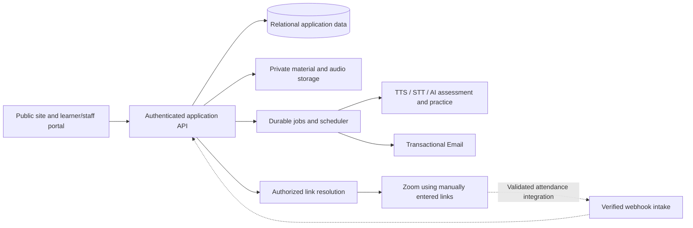

# Elite Pathway — Technical Requirements Specification

**Version:** 0.4 · **Date:** 11 October 2026 · **Status:** Requirements draft with confirmed direction and open implementation details

**Vietnamese edition:** [ELITE-TECHNICAL-SPEC.vi.md](ELITE-TECHNICAL-SPEC.vi.md)

**Source:** Client brief `Elite web.md`, supplied from `C:/Users/ThanhVanMac/Downloads/Elite web.md`, together with the client's subsequent confirmations. The Vietnamese and English portions of that brief describe the same scope and are consolidated here. Requirement IDs, decisions and release labels are identical in both editions of this specification.

This document specifies the future Project_L learning platform. It records intended behavior and confirmed product choices; it does not claim that these learning tools are implemented. Architecture, service targets and unresolved operational details remain proposals for review.

## 1. Purpose, baseline and scope

Build Project_L as a separate learning platform that connects assignments, teacher/teaching-assistant consultations, live lessons and vocabulary review for the first teaching cohorts. Preserve the existing public website's visual direction; the client will supply revised public content. Operational teaching tools take priority over a new landing-page design.

**Confirmed direction:** use **Zoom for both main classes and 1:1 consultations**, and **transactional email for reminders and eligible meeting-access notifications**. Implement the Project_L platform independently; selective reuse of suitable code is an engineering detail, not a product dependency. These choices are recorded in D01, D02 and D07.

**Confirmation — 10 October 2026:** administrators, assigned teachers and assigned teaching assistants enter existing Zoom links once for a cohort or individually for each session. Manual entry needs no Zoom API credentials. Automatic meeting creation is optional future work, not a core acceptance requirement. Email and AI scope is unchanged. Students may also request enrollment in open cohorts, with administrator approval required before actual membership; submitting a request does not grant access.

**Client requirements take priority over implementation convenience.** The requested Speaking AI workflow, improved-answer examples and AI vocabulary practice are part of the core scope. Engineering proposals may support those requirements; reducing or postponing them requires explicit client approval (D15).

### Further confirmations and implementation status — 11 October 2026

- **Main-class access (D05/Q04 confirmed):** the first main lesson is exempt. Before each subsequent main lesson, the student must complete a 1:1 review of the previous main lesson and receive confirmation from that consultation's assigned host teacher before receiving the main-class Zoom URL. Booking alone, no-show or an unrelated review is insufficient. No separate main-class homework-submission gate is added.
- **Schedule relationship:** `reviewForLessonId` points to the upcoming main lesson in the same class. The consultation starts no earlier than the preceding main lesson's end and finishes no later than the target lesson's start. The server rechecks the current noncancelled sequence, versions, access and confirmed outcome.
- **Curriculum:** the client authorized original material creation. An explicit, idempotent admin import now provides 3 original units/12 four-skill draft assignments, 3 offline synthetic-speech recordings and a private teacher guide. The new class is private, without learners, schedules, grades or submissions; teacher review and publication are required. These are authored materials, not simulated learning activity records.
- **Google Drive:** the centre selected Gmail My Drive. Administrator Google sign-in, folder browsing/selection and explicit submission-storage activation are implemented; OAuth client configuration, actual consent and real Google upload/download verification remain required. Mock responses do not establish live integration.
- **OpenAI:** the private key is present; a read-only model-list request succeeded and found the three configured models. Paid AI remains disabled because the one-month trial allowance is undecided. No actual speech generation, transcription or assessment has run. Email service, domain/hosting and pilot size are still unavailable or undecided.

These changes await this increment's final verification. They do not establish full acceptance or completion of vocabulary AI formats, Speaking sample answers or email delivery. The earlier audit remains historical evidence; refer to PRODUCT and subsequent checks for current status.

### Requirement classifications

| Code | Meaning                                                                                                        |
| ---- | -------------------------------------------------------------------------------------------------------------- |
| C    | Explicit client requirement.                                                                                   |
| F    | Future capability explicitly described by the client.                                                          |
| O    | Explicitly optional client request.                                                                            |
| D    | Desired capability whose precise scope or priority needs confirmation.                                         |
| E    | Engineering proposal or necessary supporting capability inferred from the workflow; not a direct client quote. |
| P    | Existing Project_L behavior to preserve.                                                                       |

Release sequencing and numerical service targets below are **proposals**, not approved delivery commitments. C requirements remain in the initial client core unless the client explicitly approves a deviation. Future cohort cloning is F, copy/paste restriction is O, and the exact mind-map scope is D. Supporting screens, permissions and operational controls are E where not directly specified by the client.

### Original planning baseline versus requested product

The following table records the baseline before the independent API was built, not the latest implementation status. README and PRODUCT record current capabilities and checks; the target scope still applies.

| Area             | Current verified baseline                                                                 | Target described in this document                                                  |
| ---------------- | ----------------------------------------------------------------------------------------- | ---------------------------------------------------------------------------------- |
| Public website   | Elite-style landing; VI/EN; contact email draft.                                          | Preserve layout and replace public copy when the client supplies it.               |
| Course discovery | `/courses` is a demonstration catalog with local bookmarks.                               | Authenticated access to real enrolled cohorts and their materials.                 |
| Login            | A public login entry point exists; native learner/staff authentication is not integrated. | A coherent learner/staff authentication and permission model in Project_L.         |
| Lessons          | Production lesson pages and meeting integration are not implemented.                      | Zoom for main classes and 1:1 consultations, with scheduled access and attendance. |
| Teaching tools   | No integrated production assignment, booking, vocabulary or AI workflow in Project_L.     | The capabilities in sections 3–9.                                                  |
| Backend          | No production learning backend is integrated into Project_L.                              | A separately implemented Project_L backend; technical choices remain D14.          |

**Outside this brief:** payment processing, fees/accounting, admissions CRM, parent portal, school-wide MIS/report cards, native mobile apps, official IELTS certification, meeting video recording, plagiarism detection and automatic Writing grading. These are not implied by the exercise references. Automated Reading/Listening marking also requires a separate question/answer-key decision.

## 2. Features by role

The following role actions are intended features. Their IDs link to the functional requirements in section 3; C/P/E/F/O/D retain the classifications in section 1. Dashboards, account controls, calendars, permissions and operational screens are supporting proposals (E) where they are not direct client requests. Exact account provisioning and permission grants remain D03.

### 2.1 Visitor

- View the existing public landing and course information, including the current demonstration catalog and its discovery controls; replace public copy with client-supplied content when available. Do not present demonstration courses as confirmed offerings (WEB-01, P/C).
- Switch between Vietnamese and English while browsing public pages (WEB-01, LOC-01, P).
- Use the validated contact form to prepare a `mailto` draft in an email application; the visitor sends it separately. This existing contact flow does not store or send a request from Project_L (WEB-01, P).
- Open the login entry point to access the future authenticated portal; use account recovery when an account exists (WEB-01, ACC-01, P/E).

### 2.2 Student

- Sign in, sign out, recover access and view their own account, enrollments and permitted cohorts through My Courses (ACC-01/02, CRS-01; account controls E).
- Browse public cohorts accepting enrollment, submit a request, follow their own status, cancel while pending and reapply after rejection/cancellation. Access begins only after admin approval (ENR-01).
- View their cohort's weekly topics, published assignments, deadlines, class calendar and scheduled session details; see their own next actions and course progress (CRS-01, ASN-01/02, OPS-01; calendar and summary E).
- Select a scheduled main class and open its Zoom join flow when eligible; view session status and their own attendance record (CLS-01, ATT-01/02, BKG-04; attendance view E).
- Open **Book a 1:1 review** from the overview or a consultation-only schedule, choose an available teacher-hosted slot before the main class, and manage cancellation under policy. Each slot admits one student; conflicts and Zoom state are visible. Booking is allowed before completing homework; Zoom access still requires the valid booking and current submissions (BKG-01–04).
- Complete Reading and Listening exercises, use the Listening audio player, save answers, highlight material, add private notes, look up vocabulary and explicitly save selected words to the notebook (RDL-01/02, ASN-02, VOC-01).
- Write while viewing the teacher's materials and dictionary/notebook, save and submit the essay, and use the agreed saved mind-map mode (D). Copy/paste restriction remains an optional activity setting (O), with scope resolved in D10 (WRT-01–03, ASN-02).
- Hear a teacher-authored Speaking question in an AI voice, record and play back an answer, upload it and receive a transcript. See feedback and estimated scores across all four Speaking criteria, with Fluency and Coherence first (SPK-01–03).
- Request both an approximately +1-band improved answer and a Band-9-target example, with clear target labels; highlight and save vocabulary from those examples (SPK-04, VOC-01).
- Use their private notebook across all four skills, organized by weekly topic; practice saved vocabulary through AI-generated multiple choice, gap fill, matching and sentence exercises, and track their own review activity (VOC-01–03).
- Reopen saved work, submit an attempt, see its receipt, read authorized teacher feedback and follow the next valid course action. Receive transactional emails for deadlines, bookings, lessons, gated access and vocabulary review; an in-portal notification view is supporting E (ASN-02, NTF-01/02, VOC-03, OPS-01).
- Switch the system interface language without losing work; system/content/AI-feedback language details remain D11 (LOC-01).

Private notebooks and personal annotations are accessible only to their student owner by default. Other students and staff cannot browse them. Any later sharing capability requires an explicit permission design and client decision (ACC-02, RDL-02, VOC-01).

### 2.3 Teacher

- Sign in and work within assigned cohorts, rosters, weekly topics, class schedules and main/1:1 Zoom sessions (ACC-01/02, CRS-01, CLS-01, BKG-01; scoped roster and schedule views E).
- Manage main-class schedules and the relevant assignment/prerequisite bundle within explicit D03 grants. Enter or replace the assigned cohort’s default Zoom link and select the default, an individual link or no link for each session (CLS-01/02, BKG-04).
- Create or upload assignments and Speaking questions for all four skills; edit, replace, delete/archive, version and publish materials to the intended cohort with deadlines. Preserve submitted-against versions and learner history (ASN-01/02, SPK-01).
- Review assigned learners' submissions and authorized course progress, record academic feedback, and review or override AI estimates with a recorded reason. Access to private personal notes or notebooks is not granted by this role (ASN-02, SPK-03, ACC-02; review controls E).
- Publish available 1:1 slots within the timetable and preparation policy, manage assigned consultations and record completion; distinguish a booking from a completed meeting (BKG-01/02/04).
- Record and correct attendance manually, inspect verified automatic attendance and resolve unmatched participation evidence for assigned learners (ATT-01/02).
- View course readiness from required submissions, consultation completion and authorized progress; follow up on missing prerequisites under the agreed rules (BKG-03/04, OPS-01, NTF-01/02; summary E).
- In a future capability (F), copy course topics and assignments into a new cohort as independent drafts, review dates/materials and publish without copying learner data or old meeting links (ASN-03).

### 2.4 Teaching assistant (TA)

- Read assigned cohort information, rosters, schedules, materials, attendance and preparation status (ACC-02, CRS-01, OPS-01).
- Enter, replace or remove a cohort default Zoom link, and select a source/link for individual sessions in assigned cohorts. This is the single confirmed mutation exception for this role (CLS-02).
- Receive preparation metadata without student answer text, submission files or private feedback. Private notebooks and notes remain inaccessible (ACC-02).

Link-edit permission does not authorize schedule creation/editing, 1:1 completion changes, attendance edits, content/assignment edits, grading or access overrides. Such extensions require separate confirmation; they are not inferred from Zoom-link entry. TAs do not manage enrollment, roles, global email/AI configuration or other cohorts.

### 2.5 Administrator

Administrator features are operational support proposals (E). This role does not automatically grant academic grading, feedback, assignment publishing or access to private notebooks; academic duties require a separate scoped role/grant (ACC-02, D03).

- Provision, disable and recover accounts under the approved policy; manage enrollments and assign teacher/TA cohort scopes and delegated permissions (ACC-01/02, CRS-01; D03).
- Open or close cohort enrollment requests; approve/reject requests with an optional note, creating membership atomically on approval (ENR-01).
- Set up courses, cohorts, topic structure and timetable configuration needed for teaching operations, while keeping academic content ownership separate (CRS-01, BKG-01, ACC-02).
- Enter, replace or remove Zoom defaults and session links across cohorts; manage each session’s link source without requiring Zoom API setup (CLS-02).
- Configure transactional email and AI integration settings, authorized service access and usage limits; keep credentials server-side. Automatic Zoom creation is configured only if selected as additional scope (NTF-02, SPK-01–04, VOC-02, ACC-02).
- Investigate delivery failures, scheduling failures and failed/stuck AI jobs, and safely retry eligible work without bypassing homework access rules (NTF-01/02, SPK-01–04, VOC-02, OPS-01, BKG-03).
- Inspect operational audit history, permission changes, attendance corrections and job status within approved support access; do not expose raw private learner content in operational logs (ACC-02, ATT-01/02, OPS-01).
- Apply agreed retention/deletion and recovery procedures to accounts, submissions and recordings, with authorized audit records and the D13/D14 policy (ACC-02, ASN-02; NFR-02/07).

### 2.6 Permission matrix and shared automation

This is the proposed default matrix (E). Every grant is enforced on the server and reflected in the interface. “Assigned” means an explicit learner/cohort scope; it never means all school data. D03 finalizes the grants and account provisioning method.

| Resource or action                             | Visitor          | Student           | Teacher                          | TA                                                           | Administrator                                      |
| ---------------------------------------------- | ---------------- | ----------------- | -------------------------------- | ------------------------------------------------------------ | -------------------------------------------------- |
| Public content and contact draft               | Yes              | Yes               | Yes                              | Yes                                                          | Yes                                                |
| Private cohort/course data                     | No               | Enrolled cohorts  | Assigned cohorts                 | Assigned scope                                               | Operational setup; academic access needs a grant   |
| Own account/calendar/bookings                  | Login entry only | Own               | Own and assigned teaching duties | Own and delegated duties                                     | Account/schedule administration under policy       |
| Submissions and academic feedback              | No               | Own work/feedback | Assigned learners                | Preparation metadata only; no answers/files/private feedback | Separate academic grant required                   |
| Private notebook and personal annotations      | No               | Own only          | No by default                    | No by default                                                | No by default                                      |
| Assignment upload/edit/publish/delete          | No               | No                | Assigned cohorts                 | No by default                                                | Separate academic grant required                   |
| Attendance/readiness                           | No               | Own               | Assigned cohorts                 | Read-only in assigned cohorts                                | Operational support; academic changes need a grant |
| Class/session Zoom link entry                  | No               | No                | Assigned cohorts                 | Assigned cohorts; link settings only                         | All cohorts                                        |
| Accounts/enrollments/staff scopes              | No               | No                | No by default                    | No by default                                                | Yes under approved policy                          |
| Global integrations, jobs, retention and audit | No               | No                | Limited assigned teaching status | Limited delegated status                                     | Authorized operational scope                       |

Shared system automation supports these actions: enforce enrollment and gates (ACC-02, BKG-03/04); atomically reserve slots and recalculate changed schedules (BKG-01/02); send and deduplicate transactional email reminders and eligible access notifications (NTF-01/02, VOC-03); match actual Zoom participation where reliable (ATT-02); preserve assignment/attempt versions (ASN-01/02); process Speaking AI and vocabulary practice (SPK-01–04, VOC-02); and present authorized next actions or failure states (OPS-01). These processes operate within the same permission and privacy boundaries as the role screens.

## 3. Functional requirements and acceptance criteria

### 3.1 Portal, courses and live teaching

| ID     | Class | Required behavior                                                                                                                                                               | Minimum acceptance criterion                                                                                                                                                                                                                                                                                |
| ------ | ----- | ------------------------------------------------------------------------------------------------------------------------------------------------------------------------------- | ----------------------------------------------------------------------------------------------------------------------------------------------------------------------------------------------------------------------------------------------------------------------------------------------------------- |
| WEB-01 | C/P   | Retain public visual direction and existing VI/EN behavior; accept client-provided copy later.                                                                                  | Public pages and login remain usable; no invented course claims or unapproved redesign.                                                                                                                                                                                                                     |
| ACC-01 | C/E   | Authenticate students and staff; provide logout, account recovery and cohort enrollment access.                                                                                 | An active enrolled student can open their cohort; an unenrolled or disabled account receives no private course data.                                                                                                                                                                                        |
| ACC-02 | E     | Enforce role, learner and cohort permissions, including explicit TA delegation and separate operational/academic grants.                                                        | Direct API calls cannot bypass permissions. Private notebooks and personal annotations are owner-only by default; staff see only authorized course progress and submissions.                                                                                                                                |
| CRS-01 | C/E   | Separate curricula from cohorts; organize topics, assignments, main sessions and consultations. Public listing and accepting enrollment are distinct flags.                     | Requests require an active, listed, enrollment-open cohort. Catalog fields are only ID/title/level/description/enrollmentOpen; no learner or meeting data.                                                                                                                                                  |
| ENR-01 | C/E   | Students request open cohorts; admin approves/rejects with an optional note. Students see their own requests, cancel pending requests and reapply after rejection/cancellation. | pending/approved/rejected/cancelled states; versioned approval and membership are atomic, with no duplicate pending request/membership. Teachers/TAs cannot approve; no private class/Zoom access before approval.                                                                                          |
| CLS-01 | C     | Student opens My Courses → cohort → scheduled main lesson → Join; the server checks access before returning the effective Zoom link.                                            | The correct session/source resolves; canceled sessions or absent links explain their state; ordinary listings return no URL.                                                                                                                                                                                |
| CLS-02 | C/E   | Admin, assigned teacher or assigned TA enters a HTTPS Zoom link once per cohort or individually per session; selects default, own link or none.                                 | Check current assignment/role and expected versions; retain input on errors/conflicts. Changing the cohort default affects sessions using that source, never individual links. Consultations start unconfigured and require an explicit source. TA link commands cannot edit schedules or academic records. |
| ATT-01 | C     | Provide manual attendance and corrections by authorized teaching staff as the accepted fallback.                                                                                | A teacher can record attendance against a student and session; corrections record who changed what and why.                                                                                                                                                                                                 |
| ATT-02 | C     | Automate attendance when actual participation can be reliably matched to an enrolled student.                                                                                   | Link clicks alone do not mark present; unmatched meeting participants remain unverified for teacher review. Repeated provider events do not duplicate attendance.                                                                                                                                           |

### 3.2 Scheduling, prerequisites and notifications

| ID     | Class | Required behavior                                                                                                                                                                                | Minimum acceptance criterion                                                                                                                                                                                                                                                       |
| ------ | ----- | ------------------------------------------------------------------------------------------------------------------------------------------------------------------------------------------------ | ---------------------------------------------------------------------------------------------------------------------------------------------------------------------------------------------------------------------------------------------------------------------------------- |
| BKG-01 | C     | Teacher/admin publishes cohort/topic 1:1 availability, excluding fixed lessons, conflicting bookings and invalid preparation windows. TA schedule-management rights require a separate decision. | Only valid slots appear; the server rechecks availability at booking. TA link entry does not authorize publishing slots.                                                                                                                                                           |
| BKG-02 | C     | A prominent overview entry and consultation-only schedule let students book teacher-hosted pre-class 1:1 review and view/cancel their own bookings under policy.                                 | New/edited slots have capacity one; server checks class access, time conflicts and concurrency. Booking may precede homework; Zoom join still enforces preparation. From the second main lesson, the confirmed review gate in BKG-04 applies.                                      |
| BKG-03 | C     | Release the intended consultation Zoom access by transactional email only after the booked student's required homework has been submitted.                                                       | Before valid submission, neither API responses nor notifications expose the gated meeting URL. After submission and a valid booking, access is released once. D04 settles valid-submission details and required assignment bundles; D05 settles main-class blocking and overrides. |
| BKG-04 | C     | Before every main lesson after the first, require a completed 1:1 review of the preceding main lesson, confirmed by that consultation’s assigned host teacher.                                   | The first main lesson is exempt. The server withholds later main-class Zoom URLs unless a valid completed outcome exists. Booking, no_show, unlinked reviews and invalid review windows are insufficient. No separate main-class homework-submission gate is added.                |
| NTF-01 | C     | Remind students about assignment deadlines, upcoming main/1:1 lessons and the need to book a required consultation.                                                                              | A completed assignment or cancelled booking suppresses obsolete reminders; changed dates reschedule them without duplicates.                                                                                                                                                       |
| NTF-02 | C/E   | Deliver reminders and eligible meeting-access notifications through confirmed transactional email (D07); show delivery/retry state as supporting E.                                              | Failed delivery is visible to authorized staff; a retry does not create duplicate bookings or unlock an ineligible meeting. Email content and access links respect the current enrollment, submission and booking state.                                                           |

### 3.3 Assignment lifecycle

| ID     | Class | Required behavior                                                                                                                           | Minimum acceptance criterion                                                                                                                                                         |
| ------ | ----- | ------------------------------------------------------------------------------------------------------------------------------------------- | ------------------------------------------------------------------------------------------------------------------------------------------------------------------------------------ |
| ASN-01 | C     | Teachers create/upload, edit, replace, delete/archive and publish assignments for each skill. Initial authoring is manual.                  | Drafts are invisible to students; publication exposes the intended version and deadline to the intended cohort only. Supported formats are agreed in D08.                            |
| ASN-02 | C/E   | Students save work, submit an attempt and see a submission receipt; staff can review it and record feedback. Preserve versions and history. | Reload restores acknowledged saved work; a repeated submit produces one receipt. Editing a published assignment cannot silently change the version already submitted against.        |
| ASN-03 | F     | Copy a course's assignment/topic structure into a future cohort as drafts ready for review and publishing.                                  | Copied material can be edited independently; submissions, students, attendance, bookings, private notes and old meeting URLs are never copied. Dates are reviewed before publishing. |

### 3.4 Reading, Listening and Writing workspaces

| ID     | Class | Required behavior                                                                                                                                                     | Minimum acceptance criterion                                                                                                                                                 |
| ------ | ----- | --------------------------------------------------------------------------------------------------------------------------------------------------------------------- | ---------------------------------------------------------------------------------------------------------------------------------------------------------------------------- |
| RDL-01 | C/E   | Provide a reference-inspired reading/listening exercise workspace with teacher materials and answer inputs; Listening includes an audio player.                       | Approved question types render correctly, progress is saved and answers can be submitted. Replay limits, timing and marking are not assumed; see D08.                        |
| RDL-02 | C     | Highlight text, attach private notes, look up vocabulary and explicitly save selected words to the notebook.                                                          | Notes/highlights survive reopening the same material version; lookup does not save a word until Save to Notebook is selected.                                                |
| WRT-01 | C/E   | Desktop Writing uses three areas: teacher prompt/materials; student writing workspace; dictionary/notebook. Add draft saving and a word count as supporting controls. | Students can write while viewing the prompt, reopen saved work and submit; smaller screens expose all three areas through accessible panels/tabs.                            |
| WRT-02 | O     | Optionally restrict copy/paste in the answer field, controlled per activity and clearly disclosed.                                                                    | If enabled, ordinary paste is blocked with a clear message and a staff-configurable accessibility exception. It is not presented as proof of authorship or cheat prevention. |
| WRT-03 | D     | Offer a saved mind-map area using freehand drawing or structured nodes/edges. A limited outline may replace it only if explicitly accepted under D10.                 | The approved mode can be saved/reopened per attempt without overwriting the essay. Scope and release are D10; a full Lucidchart clone is not implied.                        |

The brief names [YouPass Reading](https://e-learning.youpass.vn/practice/reading/13495) and [YouPass Writing](https://e-learning.youpass.vn/practice/writing-task-1/12060) as interaction references. Their detailed interactive pages were not available through the text retrieval used for this specification. The requirements above come from the client's descriptions, not an asserted feature audit or permission to reuse third-party content.

### 3.5 Speaking and AI feedback

| ID     | Class | Required behavior                                                                                                                                        | Minimum acceptance criterion                                                                                                                                                                                                            |
| ------ | ----- | -------------------------------------------------------------------------------------------------------------------------------------------------------- | --------------------------------------------------------------------------------------------------------------------------------------------------------------------------------------------------------------------------------------- |
| SPK-01 | C     | Teachers supply speaking questions; an AI voice reads the selected question.                                                                             | The spoken prompt corresponds to the published question version; text remains visible if voice playback fails.                                                                                                                          |
| SPK-02 | C     | Request microphone access, record and upload the answer, then transcribe it. Provide playback and retry states.                                          | No recording starts without user action/permission. The student can play back the captured answer; upload/transcription errors preserve recoverable work and do not fabricate text.                                                     |
| SPK-03 | C/E   | Produce criterion-based AI feedback and estimated scores. Open Fluency and Coherence first; provide tabs for the other criteria.                         | Every result belongs to the correct attempt and identifies its criterion, evidence, feedback and assessment version. Insufficient audio produces a limited/unscorable state, not an invented score.                                     |
| SPK-04 | C/E   | Generate two answer examples: an approximately +1-band learning target, capped at 9, and a Band-9-target example. Allow selected vocabulary to be saved. | Examples stay on topic, are separately labeled and never overwrite the student's answer. At/near 9, label the cap rather than claim an impossible +1 result. Generated examples are learning material, not guaranteed certified scores. |

The four criterion labels are **Fluency and Coherence**, **Lexical Resource**, **Grammatical Range and Accuracy**, and **Pronunciation**, as defined in the official [IELTS Speaking Band Descriptors](https://ielts.org/cdn/ielts-guides/ielts-speaking-band-descriptors.pdf). Record the rubric version used. Do not reproduce the descriptor PDF wholesale.

**Engineering constraints on AI:** pronunciation and spoken delivery require audio evidence; a text transcript alone is insufficient for a full speaking assessment. Do not infer pronunciation quality from corrected text. Preserve the original audio and machine transcript separately from any learner-corrected transcript. A teacher can review or override an estimate with an audit trail. A single short answer must not be labeled an official overall IELTS result. The source's “flawless Band 9” wording is implemented as a target-level example, not a guaranteed result.

[LuyenNoi](https://luyennoi.com/take-test/home) is the client's workflow reference; its interactive test behavior has not been independently audited for this specification.

### 3.6 Vocabulary, progress and language

| ID     | Class | Required behavior                                                                                                                                                                             | Minimum acceptance criterion                                                                                                                                                                                   |
| ------ | ----- | --------------------------------------------------------------------------------------------------------------------------------------------------------------------------------------------- | -------------------------------------------------------------------------------------------------------------------------------------------------------------------------------------------------------------- |
| VOC-01 | C/E   | Maintain each student's centralized notebook across all four skills and generated speaking examples, grouped by cohort/weekly topic. Save word/phrase, selected meaning, context and source.  | A saved item appears under the correct topic; repeated saves handle the same sense without accidental duplicates, while distinct senses can be retained.                                                       |
| VOC-02 | C/E   | Generate lightweight practice from saved words: multiple choice, gap fill, matching and sentence practice, with feedback.                                                                     | Each exercise references the learner's saved items; failures are retryable. Constrained questions have a checked answer; open sentences receive contextual feedback rather than an arbitrary exact-match mark. |
| VOC-03 | C/D   | Track review activity and remind students when saved vocabulary has not been reviewed; revisit prior topics.                                                                                  | Review completion updates the next reminder; duplicate reminders are prevented. A 14-day topic revisit is a proposed configurable default; start event and inactivity interval are D09.                        |
| OPS-01 | E     | Show each student's next actions, including vocabulary due for review, and staff course-readiness summaries from authorized course progress, required work, bookings and consultation status. | Summaries match underlying records and expose the next valid action without inventing progress or grades. Staff summaries do not grant access to private notebooks or personal annotations.                    |
| LOC-01 | P/E   | Preserve VI/EN support; propose bilingual navigation, validation, system notifications and dates in new tools.                                                                                | Language switching preserves drafts and selections. User-generated teaching content is not silently translated; content/AI-feedback language policy is D11.                                                    |

## 4. Critical business rules

### 4.1 Homework → booking → consultation → main lesson

The brief allows a booking to exist before submission, but withholds meeting access until homework is submitted. **Booking is not the same as unlocking access.**

Proposed implementation:

1. Staff links a topic's assignment(s), consultation requirement and main lesson.
2. A student books a valid available slot; the booking displays **Awaiting homework** when necessary.
3. A server-accepted submission changes the corresponding prerequisite state. A local draft, pending upload or failed upload does not count.
4. The server checks active enrollment, an active booking, required submissions and the configured access window before issuing access.
5. The reminder service sends the eligible Zoom access notification by transactional email once eligibility is met. If submission predates booking, successful booking performs the same eligibility check.
6. The assigned host teacher confirms completion or no-show. The outcome binds the target main lesson and preceding reviewed lesson; booking alone is not completion.
7. The first main lesson is exempt from 1:1 review. Later main lessons release Zoom access only after a valid completed review of the preceding lesson; no additional main-class submission gate is imposed. Operational exceptions, booking/cancellation cutoffs and Zoom admission controls remain open; no bypass permission is inferred.

**The source policy is submission-based (`submitted`).** “Submitted” must not silently become “teacher approved” or “minimum score achieved.” The client must approve any such stronger requirement. D04 resolves the validity of a server-accepted submission and the required assignment bundle; it does not reopen the trigger as an approval or score gate. Where several assignments are required, the gate evaluates the agreed set, not an unrelated submission.

A proposed valid schedule satisfies: homework due before the required preparation cutoff, consultation before its main lesson, and no overlapping student/staff class or appointment. Exact buffers, deadline exceptions and valid booking windows are configurable after D06; do not hardcode an arbitrary number of hours.

### 4.2 Meeting access and attendance

**Confirmed link rule:** a cohort may store one private default. A session selects `class`, `lesson` or `none`; consultations default to `none` and do not silently inherit the shared room. `class` resolves the current cohort default, while `lesson` retains its own link. Reusing a URL does not merge session, booking or attendance records. Link edits check current role/assignment and expected versions; failures/conflicts retain typed input. Stored URLs are not populated through general read models; only an authorized join flow returns the effective URL.

A server-protected portal join route is recommended for emails and calendar links; it checks current eligibility before resolving to the Zoom meeting. Do not embed gated join URLs in public JSON, pre-submission reminders, analytics or unrestricted calendar descriptions. Once a direct Zoom URL is disclosed, the portal alone cannot stop it being forwarded. D05 confirms the review gate after the first main lesson; authorized exceptions and provider admission controls remain open; provider-level exclusion is not guaranteed by a hidden Join button.

Opening a link is not proof of participation. Zoom exposes join/leave events, but participant email/identity can be unavailable. Match using the validated identity mechanism for the chosen integration; never assume display-name uniqueness. Unmatched events go to manual review. See [Zoom meeting webhooks](https://developers.zoom.us/docs/api/meetings/events/).

Keep separate fields for `link_clicked_at`, verified participation, attendance status and evidence source (`teacher` or `provider`). Presence-duration thresholds, late arrival and recurring meeting-instance mapping require D12. Teacher corrections are preserved rather than silently overwritten by later webhooks.

### 4.3 Notification rules

**Transactional email is confirmed (D07)** for assignment deadlines, upcoming main/1:1 Zoom lessons, consultation-booking prompts, eligible meeting access and vocabulary-review reminders. An in-portal notification list and preferences are supporting proposals (E). Email provider selection and credentials remain technical implementation details under D14; timing, quiet hours and escalation are D06.

Each notification records recipient, event, scheduled UTC time, language, channel, deduplication key and delivery state. Proposed states: `scheduled → queued → sent`, with `failed`, `cancelled` and retry history. “Sent” means email-provider acceptance, not proof that the student read it. The scheduler rechecks relevance and eligibility at send time. Authorized operational staff can see failed sends and safely retry them without exposing private learner content or overriding access gates.

### 4.4 Content and attempt integrity

Published assignments have immutable versions referenced by submissions, annotations and AI results. Deleting a used assignment archives it from new work while preserving history; permanent retention/deletion rules are D13. Cloning creates a new content/version lineage and requires a deadline review. Dictionary/provider failures show an unavailable state instead of invented definitions. AI output is untrusted content and must not execute instructions or access tools contained in prompts/submissions.

Engineering proposal: validate upload types and sizes, scan files as appropriate, and sanitize rendered text/HTML. Supported authoring formats must be agreed using real examples. Uploading a scanned PDF/image does not automatically create selectable text or structured questions; OCR and automatic question extraction are separate scope decisions under D08.

## 5. Proposed architecture and integration boundaries

Keep the installed **React + Vite + TypeScript + Tailwind + pnpm** frontend and build the authenticated learning surfaces for Project_L. Independent implementation is confirmed in D02. The following new modular backend structure is an engineering proposal; backend framework, database product, hosting and specific service implementations remain D14. Selective code reuse may be assessed for suitability without changing the platform boundary or client requirements.

Use a modular application backend initially rather than assuming multiple independently deployed microservices. The API owns authorization, booking transactions, prerequisites and versioned records. Workers own long-running AI tasks and reminders. Private media uses short-lived authorized access; browser bundles contain no service secrets. Manual Zoom-link entry requires no Zoom OAuth/app credentials. If attendance integration or optional automatic creation is added, its credentials and AI/dictionary/email keys stay server-side. External callbacks require authenticity verification, replay protection and safe retry handling.

AI pipeline: `question text → TTS`; `audio upload → transcription → audio-aware assessment → on-demand improved examples`. Vocabulary generation is a separate job. Retrying a job must not duplicate the submission, charge-triggering request where avoidable, or published result. Use provider timeouts, bounded retries, usage limits and versioned output schemas; surface failures to staff and students.

### Illustrative API contract groups — not final endpoint names

| Area                | Example contract                                                          | Essential rule                                                                                                                                    |
| ------------------- | ------------------------------------------------------------------------- | ------------------------------------------------------------------------------------------------------------------------------------------------- |
| Identity/enrollment | `GET /me`, `GET /me/cohorts`                                              | Return authorized identity and enrollments only.                                                                                                  |
| Learning            | `GET /cohorts/{id}/topics`, `GET /sessions/{id}`                          | No private meeting URL in ordinary listing responses.                                                                                             |
| Booking             | `GET /availability`, `POST /bookings`, `POST /bookings/{id}/reschedule`   | Atomic reservation; conflict response for unavailable slot.                                                                                       |
| Assignments         | `POST /assignments`, `POST /assignments/{id}/publish`                     | Staff permission and explicit published version.                                                                                                  |
| Submission          | `PUT /attempts/{id}/draft`, `POST /attempts/{id}/submit`                  | Ownership, optimistic version check and idempotent submission.                                                                                    |
| Join access         | `POST /sessions/{id}/join-access`                                         | Re-evaluate enrollment, access window and session-specific rules: a booking for 1:1; main-class prerequisites only under the approved D05 policy. |
| Attendance          | `PATCH /sessions/{id}/attendance/{studentId}`                             | Scoped staff permission and reasoned audit entry.                                                                                                 |
| Speaking            | `POST /attempts/{id}/audio-upload`, `GET /ai-jobs/{id}`                   | Private media ownership and asynchronous status.                                                                                                  |
| Vocabulary          | `POST /notebook/items`, `POST /review-sessions`                           | Per-user ownership, topic/source links and review history.                                                                                        |
| Notifications       | `GET /notifications`, `POST /notification-deliveries/{id}/retry`          | Students see their own messages; staff retry is controlled.                                                                                       |
| External events     | `POST /integrations/zoom/events` if attendance integration is implemented | Verify authenticity and deduplicate; not a dependency of manual link entry.                                                                       |
| Link configuration  | Dedicated versioned cohort-link and session-link/source commands          | Current admin/assigned teacher/assigned TA access; mutate only link settings, not schedules/academic data; return no URL in state.                |

## 6. Data model and lifecycle

A separate `EnrollmentRequest` stores learner/cohort, version and review outcome with `pending → approved | rejected | cancelled` states. Only approval creates actual membership. Students may cancel while pending and reapply after rejection/cancellation; other applicants are never disclosed to students.

| Entity group                                    | Essential data and relationships                                                                                               |
| ----------------------------------------------- | ------------------------------------------------------------------------------------------------------------------------------ |
| User / RoleAssignment / Enrollment              | Identity, locale, timezone, status; staff scope; student-to-cohort relationship.                                               |
| Course / Cohort / Topic                         | Reusable curriculum, a taught instance, and weekly topic ordering.                                                             |
| Session / ConsultationRequirement               | Main or 1:1 session, times, provider instance, assigned staff; required assignments/consultation linked to the main lesson.    |
| AvailabilitySlot / Booking                      | Staff, start/end, capacity, version; student, consultation requirement and booking status.                                     |
| Assignment / AssignmentVersion                  | Skill, topic, material references, structured questions, publish state and immutable version.                                  |
| Attempt / Submission / Feedback                 | Student, version, saved answers/essay, receipt time, attempt policy and staff feedback.                                        |
| Annotation / MediaAsset                         | Owner, material-version anchor, selected text/note; private files, audio metadata and upload state.                            |
| MeetingAccessGrant / Attendance / ProviderEvent | Eligibility decision, expiry, recipient; evidence source, participation segments, event identity and manual overrides.         |
| AIJob / Assessment / ExampleAnswer              | Attempt and audio/transcript references, status, provider/model/rubric versions, criterion feedback and target-level examples. |
| VocabularyItem / VocabularySource / ReviewEvent | Student, word/sense, topic, context/source references; exercise attempts and review dates.                                     |
| Notification / Delivery / AuditEvent            | Trigger, channel, scheduled time, deduplication key, provider status; actor/action/reason history.                             |

All times are stored as UTC instants with the relevant IANA timezone for display and recurring schedules. Confirm teaching timezone and staff/student zones; test daylight-saving changes where relevant. Do not assume that every user is in Vietnam or that the computer's current timezone is the school timezone.

Proposed state vocabularies:

- Assignment: `draft → published → archived`; revisions create a new version.
- Attempt: `draft → submitted → reviewed`; resubmission creates a revision according to D08.
- Booking: `confirmed → completed | cancelled | no_show`; access eligibility is a separate computed state such as `awaiting_homework`, `eligible`, `expired`.
- Attendance: `unverified | present | late | absent | excused`, with independent evidence metadata; final enabled statuses are D12.
- AI work: `queued → processing → succeeded | failed | needs_review`.

Use transactional slot-capacity enforcement and idempotency keys for booking/submission operations. Protect against lost draft updates using a version number. Apply uniqueness constraints to delivery/event deduplication keys. Keep cohort and student ownership explicit in query boundaries.

## 7. Non-functional requirements

These are proposed engineering acceptance requirements, not numerical commitments from the client.

| ID     | Requirement                           | Verification target                                                                                                                                                                                                                      |
| ------ | ------------------------------------- | ---------------------------------------------------------------------------------------------------------------------------------------------------------------------------------------------------------------------------------------- |
| NFR-01 | Secure access and private data        | HTTPS in production; server-side authorization on every private resource; private file access expires; secrets excluded from frontend and logs.                                                                                          |
| NFR-02 | Recording and personal-data handling  | Explain audio/AI processing and obtain the required recording permission/consent; define retention, deletion, staff access and provider data-use rules before pilot. Learner age is D13.                                                 |
| NFR-03 | Draft and upload reliability          | Proposed autosave within 5 seconds after editing stops; show saving/saved/failed truthfully. Network loss must not display false success; acknowledge recoverable versus server-saved work.                                              |
| NFR-04 | Responsive and accessible operation   | Proposed [WCAG 2.2 AA](https://www.w3.org/TR/WCAG22/) target, keyboard operation, visible focus, labels, readable contrast, reduced motion; verify 360px mobile and 1280px desktop. Three-column workspaces adapt without losing a tool. |
| NFR-05 | Performance and background work       | Proposed ordinary API p95 ≤ 1 second at the agreed pilot load, excluding uploads and external/AI processing. Agree load, media limits and AI timeouts before acceptance; long tasks show queued/processing state.                        |
| NFR-06 | AI quality and cost                   | Teacher-reviewed benchmark before release; criterion-level review, no guaranteed bands, no fabricated success on failure. Agree budgets, retry limits and permitted models/providers.                                                    |
| NFR-07 | Operations and recovery               | Correlated logs for booking, notifications and AI without raw private answers/audio; alerts for job failures; proposed daily backups and a demonstrated restore. Final recovery targets are D14.                                         |
| NFR-08 | Localization and timezone correctness | Approved VI/EN system strings; explicit date/timezone display; no draft loss on language change; duplicate-safe reminders across schedule changes and DST.                                                                               |

Browser microphone capture requires a secure context and user permission; denial or missing hardware must have actionable states. See [MDN getUserMedia](https://developer.mozilla.org/en-US/docs/Web/API/MediaDevices/getUserMedia). Ordinary paste events can be intercepted, but treating this as a comprehensive anti-cheating mechanism would be an engineering overclaim; see [MDN paste event](https://developer.mozilla.org/en-US/docs/Web/API/Element/paste_event).

## 8. Proposed release sequencing and dependencies

This sequence implements the client's core scope, including AI, before extending it. It proposes dependencies, not delivery dates or costs. Confirmed choices D01/D02/D07/D15/D16 are inputs to validation; technical difficulty does not reopen them automatically.

| Release                                              | Proposed scope                                                                                                                                                                                                                                                                                                                                                                                  | Exit condition                                                                                                                                                                                                                                                                                                                                                                  |
| ---------------------------------------------------- | ----------------------------------------------------------------------------------------------------------------------------------------------------------------------------------------------------------------------------------------------------------------------------------------------------------------------------------------------------------------------------------------------- | ------------------------------------------------------------------------------------------------------------------------------------------------------------------------------------------------------------------------------------------------------------------------------------------------------------------------------------------------------------------------------- |
| R0 — Technical validation of confirmed choices       | Validate default/individual Zoom-link entry and access, transactional email, microphone capture and full Speaking/vocabulary AI. Evaluate automated attendance/identity separately from manual entry. Resolve formats, privacy, permissions and acceptance data.                                                                                                                                | Evidence supports confirmed choices; no Zoom OAuth setup is required for pasted links. Remaining policy questions, including D10, require explicit agreement.                                                                                                                                                                                                                   |
| R1 — Full client core                                | Preserve WEB-01; implement ACC-01/02, CRS-01, ENR-01, CLS-01/02, ATT-01, BKG-01–04, NTF-01/02 with email, ASN-01/02, RDL-01/02, WRT-01, **all SPK-01–04 and VOC-01–03**, and supporting OPS-01/LOC-01. Include ATT-02 where reliable; the brief's accepted manual attendance fallback may operate otherwise. Implement WRT-03 according to the explicit D10 agreement; WRT-02 remains optional. | A student completes all four skill workflows, receives four-criterion Speaking feedback and both improved examples, practices topic vocabulary and receives review emails, books and prepares for a 1:1 consultation, attends it and joins the main class. Assigned staff can operate the cohort with the approved permission and access rules. Core acceptance scenarios pass. |
| R2 — Reliability and hardening                       | Improve recovery, observability, AI quality, performance and operational reliability; add reliable ATT-02 automation where R1 used the accepted manual fallback.                                                                                                                                                                                                                                | Failure/retry, permission, restore and performance checks pass the agreed targets; verified attendance and manual corrections coexist correctly. No missing core AI capability is presumed to be deferred here.                                                                                                                                                                 |
| R3 — Future cloning and explicitly agreed extensions | ASN-03 future cohort cloning; WRT-02 paste restriction if selected; other extensions only with explicit client agreement. WRT-03 follows D10 and is not automatically placed in R3.                                                                                                                                                                                                             | New-cohort drafts are independent and omit learner data and old meeting URLs; each agreed extension passes its own acceptance criteria.                                                                                                                                                                                                                                         |

Any reduction or deferral of a C requirement requires explicit client approval recorded against the affected IDs (D15). The mind-map requirement remains D and must be resolved in D10 rather than silently dropped or replaced. No schedule, budget, provider charge or delivery commitment is asserted here.

## 9. End-to-end acceptance scenarios

| ID     | Scenario and expected result                                                                                                                                                                                                                                                                                                                             |
| ------ | -------------------------------------------------------------------------------------------------------------------------------------------------------------------------------------------------------------------------------------------------------------------------------------------------------------------------------------------------------- |
| UAT-01 | Enrolled and unenrolled accounts request the same private cohort/resource: only the authorized account receives it, including through direct API calls. Verify assigned teacher/TA scopes, separate admin academic grants, and owner-only private notebooks/personal annotations.                                                                        |
| UAT-02 | A student finds overview review booking, filters consultation slots and books before submitting. Two students book one capacity-one slot: exactly one succeeds and the other sees a conflict. Cancellation updates availability; access/Zoom gates remain independent.                                                                                   |
| UAT-03 | A student books before submitting, then submits: no gated Zoom URL is accessible before valid server acceptance; afterward the correct transactional email access notification is produced once. Repeat with submission before booking.                                                                                                                  |
| UAT-04 | Cancel/reschedule a booking or change an assignment deadline: obsolete reminders/access are invalidated and eligibility is recalculated according to the approved policy.                                                                                                                                                                                |
| UAT-05 | A student clicks Join but never enters the meeting: not automatically present. A verified participant or teacher entry establishes attendance; duplicate/reordered events preserve one coherent record.                                                                                                                                                  |
| UAT-06 | Save and reopen an essay, answers, annotation and word; interrupt the network during a save/upload: previously acknowledged data persists and unsaved state is explicit.                                                                                                                                                                                 |
| UAT-07 | Complete Speaking: prompt audio, recording, transcript, four criterion views and two labeled examples work; denied microphone, silent audio, transcription failure and AI timeout have recoverable outcomes.                                                                                                                                             |
| UAT-08 | Save words from every skill and a generated sample: each appears in the correct topic, can drive practice, and triggers only the configured outstanding-review reminders.                                                                                                                                                                                |
| UAT-09 | Clone a prior cohort's content: new drafts are independent and contain no old student data, attendance, bookings or join URLs.                                                                                                                                                                                                                           |
| UAT-10 | Switch VI/EN and use mobile/keyboard while learning, booking or editing links: saved work remains intact and errors/conflicts preserve input.                                                                                                                                                                                                            |
| UAT-11 | Admin, assigned teacher and assigned TA save a cohort default; shared-source sessions follow changes, individual links remain unchanged. TA can edit links but cannot edit schedules/grades. Students and out-of-scope staff cannot edit; state/catalog expose no URL. Ineligible consultations never return the link, including shared-source sessions. |
| UAT-12 | Student requests an open cohort: no private class/Zoom access before admin approval. Teacher/TA approval API calls fail. Admin approval creates one membership and approved outcome atomically; test rejection, pending cancellation, reapplication and concurrent decisions.                                                                            |

The client-requested simulated data and functional QA must use an explicitly labeled, isolated QA application/database. Do not seed real data with fixtures or treat mocked services as evidence of provider integration.

## 10. Confirmed decisions and remaining details

### 10.1 Confirmed decisions

| ID  | Confirmed decision                                                                                                    | Implementation boundary                                                                                                                                                      | Owner                                 |
| --- | --------------------------------------------------------------------------------------------------------------------- | ---------------------------------------------------------------------------------------------------------------------------------------------------------------------------- | ------------------------------------- |
| D01 | Zoom with manual link entry — confirmed 10 October 2026.                                                              | Admin, assigned teacher or TA enters a cohort default or an individual session link. Automatic creation is optional future work; pasting a link requires no API credentials. | Client/product owner                  |
| D02 | Build Project_L as an independent learning platform.                                                                  | Selective reuse of suitable code is an engineering detail. Backend/hosting choices remain D14; account provisioning remains D03.                                             | Client/product owner + technical lead |
| D07 | Transactional email for reminders and eligible access.                                                                | Email provider under D14; timing under D06; in-portal notices are supporting E.                                                                                              | Client/operations owner               |
| D16 | Admin-approved enrollment requests — 10 October 2026.                                                                 | A student request never auto-enrolls; only admin approval creates membership atomically.                                                                                     | Client/product owner                  |
| D15 | Client requirements take priority; the initial core includes the full requested Speaking AI and vocabulary workflows. | Follow R1 coverage of SPK-01–04 and VOC-01–03. Any reduction or deferral of C scope needs explicit client approval; technical convenience is not approval.                   | Client/product owner                  |

### 10.2 Remaining implementation and operational details

| ID  | Detail to resolve                                                                                                                                  | Proposed direction or fixed boundary                                                                                                                                                                                                                                                                       | Owner                       |
| --- | -------------------------------------------------------------------------------------------------------------------------------------------------- | ---------------------------------------------------------------------------------------------------------------------------------------------------------------------------------------------------------------------------------------------------------------------------------------------------------- | --------------------------- |
| D03 | Account provisioning/self-registration and any additional staff grants?                                                                            | Student enrollment requests require admin approval (ENR-01); approval versus automatic joining is settled. TAs edit assigned-cohort links only; other academic operations stay read-only with answers/files/private feedback redacted.                                                                     | Client/product owner        |
| D04 | What is a valid server-accepted submission, and which assignment bundle satisfies each consultation prerequisite?                                  | **Submission is the fixed source trigger.** Local drafts or failed uploads do not count. Do not add teacher approval or a passing-score gate without an explicit client change.                                                                                                                            | Academic owner              |
| D05 | Main-class entry requirements and operational exceptions/Zoom admission controls?                                                                  | **Confirmed 11 October:** the first main lesson is exempt; every later lesson needs a completed 1:1 review of the previous lesson, confirmed by its host teacher. No separate main-class submission gate is added. No bypass is granted; handling disclosed URLs and Zoom admission controls remains open. | Academic owner              |
| D06 | Slot duration/buffers, booking/change/cancellation cutoffs, lateness/no-show, timezones, reminder timing and quiet hours?                          | A teacher-hosted 1:1 slot has one student place, with a clear pre-class review booking entry. Avoid conflicts; booking before homework is allowed. Remaining time parameters stay open.                                                                                                                    | Academic/operations owner   |
| D08 | Question/file formats, timers, listening playback rules, answer keys, grading, late work and resubmissions?                                        | Approve representative assignments for all four skills; do not assume automatic marking outside Speaking.                                                                                                                                                                                                  | Academic owner              |
| D09 | What counts as vocabulary reviewed, and when does the 14-day interval begin?                                                                       | Configure separate inactivity and topic-revisit rules; agree start event and completion criteria.                                                                                                                                                                                                          | Academic owner              |
| D10 | Which saved mind-map mode and release are required, and is optional paste restriction wanted?                                                      | Confirm freehand or structured mapping and acceptance criteria. Replacing a map with an outline or deferring it needs explicit agreement; paste restriction remains O.                                                                                                                                     | Client/product owner        |
| D11 | New-tool UI, notification, content, dictionary and AI-feedback languages?                                                                          | Bilingual system interface; preserve original teaching content unless a translation policy is agreed.                                                                                                                                                                                                      | Academic/product owner      |
| D12 | Waiting-room/passcode/sign-in rules, handling previously disclosed links, and identity/duration thresholds if attendance automation is integrated? | Default/individual manual links and the three editor roles are confirmed. Portal gating does not replace Zoom admission controls; validate automated attendance separately and retain manual attendance/corrections.                                                                                       | Technical + academic owners |
| D13 | Learner age, recording consent, retention/deletion and provider data policy?                                                                       | Confirm before real learner audio or personal data enters external services.                                                                                                                                                                                                                               | Client/data owner           |
| D14 | Backend/hosting/service implementations, expected load, availability/recovery targets and spending caps?                                           | Select after R0 validation within confirmed Zoom/email/independent-platform choices; no production hosting or cost commitment yet.                                                                                                                                                                         | Client + technical lead     |

## 11. Source traceability and handoff

| Client brief area                                                        | Requirement coverage                                                                                               |
| ------------------------------------------------------------------------ | ------------------------------------------------------------------------------------------------------------------ |
| Existing UI acceptable; teaching tools first                             | WEB-01; sections 1 and 8.                                                                                          |
| Confirmed independent Project_L implementation and client scope priority | D02/D15; sections 1, 5 and 8.                                                                                      |
| Zoom main classes/1:1 and attendance                                     | CLS-01/02, ATT-01/02, BKG-01–04; D01/D05/D12.                                                                      |
| Booking, submission gates and confirmed email reminders                  | BKG-01–04, NTF-01/02; D04/D06/D07; section 4.                                                                      |
| Assignment management and future copying                                 | ASN-01–03.                                                                                                         |
| Listening/Reading interaction tools                                      | RDL-01/02, VOC-01.                                                                                                 |
| Three-part Writing, paste restriction, mind maps                         | WRT-01–03.                                                                                                         |
| Speaking voice/recording/transcript/scoring/examples                     | SPK-01–04.                                                                                                         |
| Topic notebook, AI practice and review reminders                         | VOC-01–03.                                                                                                         |
| Role responsibilities and private learning data                          | Section 2; ACC-01/02, ASN-02, RDL-02, VOC-01, OPS-01; D03/D13.                                                     |
| Supporting technical proposals                                           | ACC-02, OPS-01, LOC-01, role/calendar/admin screens, architecture/data/NFR sections; clearly marked E or proposed. |

Technical sources were checked on 10 October 2026 and are linked beside the relevant claims. Provider capabilities and entitlements must be revalidated during integration. This specification contains no provider credentials, payment commitments, or copied third-party exercise content.

**Handoff deliverables for implementation:** resolved remaining decisions, representative teaching materials, finalized permission matrix, API/data contracts, integration test evidence, bilingual system copy, phased backlog linked to these IDs, and UAT results. Confirmed decisions remain the baseline. These are future implementation deliverables; this document does not claim that the learning platform is built.
