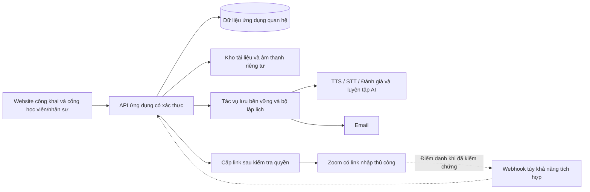

# Elite Pathway — Đặc tả yêu cầu kỹ thuật

**Phiên bản:** 0.4 · **Ngày:** 11 tháng 10 năm 2026 · **Trạng thái:** Đặc tả theo vai trò; nền tảng học trực tuyến và kênh thông báo đã chốt

**Bản tiếng Anh:** [ELITE-TECHNICAL-SPEC.en.md](ELITE-TECHNICAL-SPEC.en.md)

**Nguồn:** Bản mô tả yêu cầu của khách hàng `Elite web.md`, được cung cấp từ `C:/Users/ThanhVanMac/Downloads/Elite web.md`, cùng các xác nhận tiếp theo của khách hàng. Phần tiếng Việt và tiếng Anh trong bản mô tả đó trình bày cùng một phạm vi và được hợp nhất tại đây. Mã yêu cầu, mã quyết định và nhãn giai đoạn phát hành giống nhau trong cả hai bản của đặc tả này.

Tài liệu này xác định các tính năng Project_L sẽ có, theo yêu cầu khách hàng và các quyết định bổ sung đã được xác nhận: xây dựng Project_L độc lập, dùng Zoom và gửi thông báo qua email. Yêu cầu khách hàng được ưu tiên hơn giả định cũ hoặc sự thuận tiện khi triển khai. Các chức năng mục tiêu dưới đây chưa đồng nghĩa với chức năng đã được xây dựng; lựa chọn nhà cung cấp dịch vụ cụ thể và chi tiết vận hành còn mở được ghi riêng.

## 1. Mục tiêu sản phẩm và phạm vi đã chốt

Project_L là website học ngoại ngữ được xây dựng lại để phục vụ quy trình giảng dạy của khách hàng. Hệ thống kết nối khóa học, bài tập, buổi hỗ trợ học tập 1:1, lớp học trực tuyến và ôn tập từ vựng. Có thể đánh giá tái sử dụng các thành phần phù hợp ở mức triển khai; kiến trúc và trải nghiệm sản phẩm phải đáp ứng đặc tả này.

### Quyết định nền tảng

- **Zoom — xác nhận ngày 10/10/2026:** quản trị viên, giáo viên hoặc trợ giảng được phân công nhập link có sẵn một lần cho lớp hoặc riêng từng buổi. Không yêu cầu tự tạo cuộc họp hay tài khoản API Zoom để nhập link. Tự tạo cuộc họp là tùy chọn tương lai, không phải điều kiện nghiệm thu lõi.
- **Đăng ký lớp — xác nhận ngày 10/10/2026:** học viên gửi yêu cầu vào lớp đang mở đăng ký; chỉ quản trị viên duyệt mới tạo ghi danh. Không tự vào lớp khi gửi yêu cầu.
- **Email:** kênh gửi nhắc lịch, nhắc hạn nộp, xác nhận lịch hẹn và liên kết tham gia khi đủ điều kiện.
- **Ưu tiên khách hàng:** giữ đầy đủ công cụ học tập đã yêu cầu, bao gồm AI Speaking, mẫu câu trả lời cải thiện và luyện từ vựng bằng AI. Không tự chuyển các tính năng cốt lõi sang giai đoạn sau vì thuận tiện cho phát triển.
- **Giao diện công khai:** giữ định hướng hiện có; nội dung mới do khách hàng cung cấp. Tập trung phát triển công cụ giảng dạy và cổng học tập.
- **Ngoại lệ đã có trong yêu cầu:** điểm danh thủ công là phương án dự phòng được khách hàng chấp nhận; sao chép bài tập sang khóa sau là tính năng tương lai; hạn chế sao chép/dán là tùy chọn. Sơ đồ tư duy là tính năng mong muốn cần chốt cách tương tác, không mặc nhiên bị loại khỏi phạm vi.

### Xác nhận và hiện trạng bổ sung ngày 11/10/2026

- **Điều kiện buổi chính (D05/Q04 đã chốt):** buổi chính đầu tiên được miễn. Từ buổi chính thứ hai, học viên phải hoàn thành 1:1 ôn kiến thức của buổi chính trước đó và được đúng giáo viên phụ trách 1:1 xác nhận, rồi mới nhận link Zoom buổi chính. Chỉ đặt lịch, vắng mặt hoặc review không liên quan không đáp ứng điều kiện. Không thêm điều kiện nộp bài riêng cho lớp chính.
- **Liên kết lịch:** trường `reviewForLessonId` trỏ đến buổi chính sắp tới trong cùng lớp. Buổi 1:1 bắt đầu không sớm hơn lúc kết thúc buổi chính trước và kết thúc không muộn hơn lúc bắt đầu buổi chính đích. Máy chủ kiểm tra lại thứ tự buổi chưa hủy, phiên bản, quyền hiện tại và kết quả xác nhận.
- **Học liệu:** khách hàng cho phép tự biên soạn. Đã có cơ chế quản trị nhập một lần bộ gốc 3 bài học/12 bài tập nháp đủ bốn kỹ năng, 3 audio giọng tổng hợp ngoại tuyến và hướng dẫn riêng cho giáo viên. Lớp mới riêng tư, chưa có người học/lịch/điểm/bài nộp; cần giáo viên duyệt và công bố. Đây là nội dung giảng dạy được tạo theo yêu cầu, không phải dữ liệu hoạt động học giả lập.
- **Google Drive:** dùng Gmail My Drive của trung tâm. Giao diện quản trị đăng nhập Google, duyệt/chọn thư mục và bật lưu bài nộp đã được triển khai; vẫn cần cấu hình OAuth client, cấp quyền thật và kiểm thử upload/download với Google. Không dùng kết quả giả lập làm bằng chứng tích hợp thật.
- **OpenAI:** khóa đã có trong tệp cấu hình riêng; yêu cầu chỉ đọc danh sách model đã thành công và thấy ba model cấu hình. Cờ AI trả phí vẫn tắt vì ngân sách thử một tháng chưa chốt. Chưa chạy sinh giọng, chép lời hoặc chấm AI thật. Email, tên miền/hosting và quy mô thử vẫn chưa có/chưa chốt.

Các thay đổi trên đang chờ đợt kiểm tra cuối của lần triển khai này. Chúng không xác nhận hoàn tất toàn bộ phạm vi, các dạng luyện từ AI, bài mẫu Speaking hay email. Báo cáo audit trước đó giữ nguyên giá trị lịch sử; xem PRODUCT và bằng chứng kiểm tra mới để biết hiện trạng.

### Phân loại yêu cầu

| Mã  | Ý nghĩa                                                                  |
| --- | ------------------------------------------------------------------------ |
| C   | Yêu cầu được khách hàng nêu rõ.                                          |
| F   | Tính năng tương lai được khách hàng nêu rõ.                              |
| O   | Yêu cầu được khách hàng xác định là tùy chọn.                            |
| D   | Tính năng mong muốn, cần làm rõ cách thực hiện hoặc phạm vi chi tiết.    |
| E   | Chức năng hỗ trợ hoặc biện pháp kỹ thuật để vận hành yêu cầu khách hàng. |
| P   | Hành vi hiện có của Project_L cần giữ lại.                               |

Các thông số kỹ thuật định lượng và thứ tự phát triển là đề xuất. Chúng không được tự làm giảm phạm vi yêu cầu loại C. Những thay đổi ảnh hưởng trải nghiệm học tập hoặc loại bỏ yêu cầu cần được khách hàng xác nhận.

### Baseline khi lập đặc tả và mục tiêu

Bảng dưới lưu mốc trước khi xây dựng API riêng, không phải hiện trạng triển khai mới nhất. Hiện trạng và bằng chứng kiểm tra được ghi trong README và PRODUCT; phạm vi mục tiêu vẫn áp dụng.

| Hạng mục                     | Hiện trạng Project_L                                                        | Tính năng mục tiêu                                                                   |
| ---------------------------- | --------------------------------------------------------------------------- | ------------------------------------------------------------------------------------ |
| Trang công khai              | Landing page và chế độ VI/EN; liên hệ tạo bản nháp email.                   | Giữ giao diện; thay nội dung theo khách hàng; dẫn vào cổng học tập thống nhất.       |
| Danh mục khóa học            | Danh mục minh họa với bộ lọc và lưu khóa trên thiết bị.                     | Hiển thị khóa/lớp thực tế; học viên truy cập nội dung theo ghi danh.                 |
| Tài khoản và công cụ học tập | Chưa có hệ thống giảng dạy tích hợp để vận hành chính thức trong Project_L. | Xác thực, phân quyền theo vai trò, bài tập, đặt lịch, Zoom, email, AI và sổ từ vựng. |

**Chưa thuộc yêu cầu hiện tại:** thanh toán, học phí/kế toán, CRM tuyển sinh, cổng phụ huynh, quản lý toàn trường, ứng dụng di động native, chứng nhận IELTS chính thức, ghi hình cuộc họp, phát hiện đạo văn và chấm Writing tự động. Chỉ bổ sung khi khách hàng yêu cầu. Chấm Reading/Listening tự động cần chốt dạng câu hỏi và đáp án chuẩn.

## 2. Tính năng theo từng vai trò

Danh sách dưới đây là bản đồ chức năng chính của sản phẩm. Mã trong ngoặc liên kết đến quy tắc và tiêu chí nghiệm thu tại mục 3. Các chức năng vận hành bổ sung được đánh dấu E; giữ nguyên tính chất F/O/D của các yêu cầu tương lai, tùy chọn hoặc cần làm rõ.

### 2.1 Khách truy cập

- Xem trang giới thiệu, thông tin giảng viên và thông tin khóa học do khách hàng cung cấp. (WEB-01)
- Chuyển giao diện tiếng Việt/tiếng Anh. (WEB-01, LOC-01)
- Sử dụng thông tin liên hệ và form tạo bản nháp email hiện có. (WEB-01, P)
- Đi đến đăng nhập; khôi phục tài khoản khi đã có tài khoản. Cách cấp tài khoản hoặc cho phép tự đăng ký được chốt trong D03. (ACC-01, E)

Khách truy cập không xem tài liệu riêng tư, danh sách học viên, bài nộp hoặc liên kết Zoom của lớp.

### 2.2 Học viên

- Đăng nhập/đăng xuất, khôi phục tài khoản và thiết lập ngôn ngữ, múi giờ cho tài khoản của mình. (ACC-01, LOC-01; thiết lập tài khoản là E)
- Xem lớp công khai đang nhận đăng ký, gửi yêu cầu, theo dõi trạng thái của mình; hủy khi chờ duyệt và đăng ký lại sau từ chối/hủy. Chỉ được truy cập lớp sau khi quản trị duyệt. (ENR-01)
- Xem **Khóa học của tôi**, lớp đã ghi danh, chủ đề theo tuần, tài liệu và bài tập được đăng cho lớp. (CRS-01, ASN-01)
- Xem lịch học, hạn nộp, lịch 1:1, điều kiện chuẩn bị và việc cần làm tiếp theo. (BKG-04, NTF-01, OPS-01)
- Mở buổi học của mình và chọn **Tham gia Zoom** khi đáp ứng quy tắc truy cập; xem trạng thái điểm danh của chính mình. (CLS-01, ATT-01/02)
- Mở **Đặt lịch ôn bài 1:1** từ tổng quan hoặc lịch tư vấn riêng, chọn giờ trống do giáo viên phụ trách để ôn trước lớp chính. Mỗi khung một học viên; kiểm tra trùng giờ, cho hủy theo chính sách và hiển thị trạng thái Zoom. Được đặt trước khi nộp đủ bài; đặt lịch chưa cấp link Zoom. (BKG-01–03)
- Làm bài, lưu nháp, nộp bài và xem xác nhận đã nộp; nộp lại theo chính sách. Sau khi nộp đủ bài bắt buộc và có lịch hẹn hợp lệ, nhận email cấp quyền vào buổi 1:1. (ASN-02, BKG-03, NTF-02)
- **Reading/Listening:** xem tài liệu/câu hỏi, nghe audio, nhập câu trả lời, highlight, ghi chú, tra từ và chọn lưu vào sổ từ vựng. (RDL-01/02, VOC-01)
- **Writing:** dùng ba khu vực đề bài – bài viết – từ điển; lưu nháp, đếm từ, nộp bài; sử dụng sơ đồ tư duy theo chế độ được chốt. Hạn chế sao chép/dán chỉ áp dụng nếu được bật cho bài đó. (WRT-01/03; WRT-02 là O)
- **Speaking:** nghe câu hỏi bằng giọng AI, ghi âm/nghe lại, nhận bản chép lời và phản hồi theo bốn tiêu chí; xem Fluency and Coherence trước rồi chuyển các thẻ còn lại. Xem mẫu hướng tới +1 band và Band 9; highlight/lưu từ trong mẫu. Điểm AI là ước tính học tập. (SPK-01–04)
- Dùng sổ từ vựng tập trung theo lớp/chủ đề tuần; xem từ, nghĩa, ngữ cảnh và nguồn đã lưu từ mọi kỹ năng. (VOC-01)
- Ôn bằng bài tập AI như trắc nghiệm, điền chỗ trống, ghép cặp và đặt câu; theo dõi lần ôn và nhận email nhắc ôn, gồm quy tắc ôn lại chủ đề sau khoảng hai tuần được cấu hình theo D09. (VOC-02/03)
- Xem phản hồi bài nộp, tiến độ chuẩn bị, lịch hẹn và email nhắc hạn/nhắc buổi học liên quan tới mình. (ASN-02, OPS-01, NTF-01/02)

Học viên chỉ truy cập dữ liệu của mình và nội dung của lớp đang có quyền truy cập. Notebook và ghi chú cá nhân không mặc nhiên được chia sẻ cho nhân sự.

### 2.3 Giáo viên

- Xem các lớp, học viên và chủ đề được phân công; tổ chức nội dung giảng dạy theo tuần. (CRS-01, OPS-01)
- Quản lý lịch buổi học của lớp được phân công và các bài tập/điều kiện chuẩn bị tương ứng trong quyền được cấp rõ theo D03. Nhập hoặc thay link Zoom chung của lớp, chọn dùng link chung, link riêng hoặc chưa có link cho từng buổi. (CLS-01/02, BKG-04)
- Công bố thời gian rảnh, quản lý lịch 1:1, thực hiện buổi hỗ trợ và xác nhận hoàn thành. (BKG-01/02/04)
- Tải lên/tạo, chỉnh sửa, thay thế, lưu trữ/xóa và đăng bài tập cho từng kỹ năng; đặt hạn nộp và giữ lịch sử phiên bản. Bản nháp chưa hiển thị cho học viên. (ASN-01)
- Cung cấp tài liệu Reading/Listening, audio, đề Writing và câu hỏi Speaking cho AI đọc. (RDL-01, WRT-01, SPK-01)
- Xem bài đã nộp của học viên được phân công, phản hồi/chấm thủ công khi phù hợp và xem lại kết quả AI Speaking. Điều chỉnh điểm AI phải lưu lý do và lịch sử. (ASN-02, SPK-03)
- Xem học viên nào còn thiếu bài, chưa đặt lịch hoặc chưa hoàn thành 1:1 để theo dõi việc chuẩn bị cho buổi học chính. Chỉ xem tiến độ ôn tập được cấp quyền, không tự đọc notebook riêng tư. (BKG-04, OPS-01)
- Xem kết quả điểm danh tự động; ghi nhận hoặc sửa điểm danh thủ công khi cần, kèm lý do. (ATT-01/02)
- Theo dõi thông báo của lớp khi có quyền và báo lỗi gửi email để vận hành xử lý; không mặc nhiên có chức năng gửi email quảng cáo hàng loạt. (NTF-02, E)
- **Tương lai:** sao chép cấu trúc chủ đề/bài tập sang lớp mới, chỉnh sửa và đăng; không sao chép dữ liệu học viên. (ASN-03, F)

Giáo viên thao tác trong phạm vi lớp được phân công. Quyền cấp tài khoản, thay đổi vai trò và cấu hình dịch vụ toàn hệ thống thuộc khu vực quản trị.

### 2.4 Trợ giảng (TA)

- Xem thông tin lớp, học viên, lịch, học liệu, điểm danh và trạng thái chuẩn bị trong lớp được phân công. (ACC-02, CRS-01, OPS-01)
- Nhập/thay/xóa link Zoom chung của lớp hoặc chọn nguồn link cho từng buổi trong lớp được phân công. Đây là ngoại lệ ghi dữ liệu duy nhất được xác nhận cho vai trò TA. (CLS-02)
- Chỉ nhận metadata chuẩn bị: không nhận văn bản câu trả lời, tệp bài nộp hoặc phản hồi riêng của học viên. Không đọc notebook hoặc ghi chú cá nhân. (ACC-02)

Quyền sửa link không cấp quyền tạo/sửa lịch, xác nhận hoàn thành 1:1, sửa điểm danh, học liệu, bài tập, chấm bài hoặc cấp ngoại lệ truy cập. Những quyền mở rộng này cần xác nhận riêng; không suy ra từ việc TA được nhập link Zoom. Không quản lý ghi danh, vai trò, cấu hình email/AI hoặc lớp khác.

### 2.5 Quản trị viên

Các chức năng dưới đây là hỗ trợ vận hành (E) cho website học tập:

- Tạo/mời, cập nhật hoặc vô hiệu hóa tài khoản; hỗ trợ quy trình khôi phục tài khoản. (ACC-01/02)
- Bật/tắt nhận đăng ký cho lớp; duyệt hoặc từ chối yêu cầu của học viên, có ghi chú tùy chọn; duyệt và tạo thành viên trong cùng giao dịch. (ENR-01)
- Tạo cấu trúc khóa/lớp, quản lý ghi danh và phân công giáo viên/TA; cấp quyền theo vai trò và phạm vi lớp. (CRS-01, ACC-02)
- Nhập/thay/xóa link Zoom chung hoặc riêng từng buổi; quản lý nguồn link cho các lớp. Nhập link không cần cấu hình API Zoom. (CLS-02)
- Cấu hình dịch vụ **email**, nhà cung cấp AI/từ điển và các tham số kỹ thuật đã được thống nhất; bảo vệ thông tin xác thực phía máy chủ. Tích hợp tạo họp Zoom tự động chỉ triển khai nếu được chọn bổ sung. (NTF-02, SPK-01–04, VOC-02, E)
- Thiết lập cấu hình chung về múi giờ, nhắc lịch và quy tắc vận hành theo chính sách học thuật đã được chốt. (BKG-01–04, NTF-01, LOC-01, E)
- Theo dõi gửi email thất bại, thử lại tác vụ có kiểm soát, kiểm tra lỗi xử lý âm thanh/AI và hạn mức sử dụng. (NTF-02, NFR-06/07)
- Xem nhật ký hoạt động, quản lý sao lưu/khôi phục và thực hiện quy tắc lưu giữ/xóa dữ liệu đã thống nhất. (NFR-01/02/07)

Vai trò quản trị vận hành không tự cấp quyền chấm điểm, biên tập học thuật hoặc đọc không giới hạn các bản ghi âm/bài làm/ghi chú riêng tư. Nếu một người đồng thời là giáo viên, cấp thêm vai trò học thuật phù hợp.

### 2.6 Phân quyền và các tác vụ tự động dùng chung

| Nhóm dữ liệu/thao tác                          | Học viên                          | Giáo viên                           | TA                                                          | Quản trị viên                         |
| ---------------------------------------------- | --------------------------------- | ----------------------------------- | ----------------------------------------------------------- | ------------------------------------- |
| Nội dung khóa/lớp                              | Lớp đã ghi danh, nội dung đã đăng | Lớp được phân công                  | Lớp được phân công, theo quyền                              | Quản lý cấu trúc và phân công         |
| Bài nộp và kết quả Speaking                    | Của mình                          | Bài nộp của học viên được phân công | Chỉ metadata chuẩn bị; không câu trả lời/tệp/nhận xét riêng | Không đọc nội dung học thuật mặc định |
| Bản nháp, highlight, ghi chú và notebook riêng | Của mình                          | Không truy cập mặc định             | Không truy cập mặc định                                     | Không truy cập mặc định               |
| Đăng/chỉnh sửa bài tập                         | Không                             | Trong lớp được phân công            | Không                                                       | Cần vai trò học thuật bổ sung         |
| Lịch 1:1 và điểm danh                          | Lịch và trạng thái của mình       | Trong lớp/buổi được phân công       | Chỉ đọc trong lớp được giao                                 | Hỗ trợ vận hành có kiểm soát          |
| Nhập link Zoom chung/riêng                     | Không                             | Lớp được phân công                  | Lớp được phân công; chỉ sửa link                            | Toàn bộ lớp                           |
| Ghi danh, vai trò, tích hợp toàn hệ thống      | Không                             | Không mặc định                      | Không                                                       | Có, kèm nhật ký                       |

Kiểm tra quyền ở cả giao diện và máy chủ; gọi API trực tiếp không được vượt giới hạn. Giới hạn truy cập áp dụng cả cho tài liệu, audio, kết quả AI và URL Zoom.

Hệ thống tự xử lý: kiểm tra điều kiện cấp link Zoom; điểm danh khi xác minh được việc tham gia; lên lịch/gửi lại email có chống trùng; xử lý AI Speaking và luyện từ; cập nhật lịch ôn từ vựng. Đây là tác vụ hệ thống phục vụ các vai trò trên, không phải một vai trò người dùng mới.

## 3. Yêu cầu chức năng và tiêu chí nghiệm thu

### 3.1 Cổng học tập, khóa học và giảng dạy trực tuyến

| ID     | Loại | Hành vi yêu cầu                                                                                                                                      | Tiêu chí nghiệm thu tối thiểu                                                                                                                                                                                                                 |
| ------ | ---- | ---------------------------------------------------------------------------------------------------------------------------------------------------- | --------------------------------------------------------------------------------------------------------------------------------------------------------------------------------------------------------------------------------------------- |
| WEB-01 | C/P  | Giữ định hướng giao diện công khai và hành vi VI/EN hiện tại; tiếp nhận nội dung do khách hàng cung cấp sau.                                         | Các trang công khai và chức năng đăng nhập vẫn sử dụng được; không tự đặt ra tuyên bố về khóa học hoặc thiết kế lại khi chưa được phê duyệt.                                                                                                  |
| ACC-01 | C/E  | Xác thực học viên và nhân sự; cung cấp đăng xuất, khôi phục tài khoản và quyền truy cập theo ghi danh lớp.                                           | Học viên có tài khoản hoạt động và đã ghi danh có thể mở lớp của mình; tài khoản chưa ghi danh hoặc bị vô hiệu hóa không nhận được dữ liệu khóa học riêng tư.                                                                                 |
| ACC-02 | E    | Thực thi quyền theo vai trò, học viên và lớp; phân biệt quyền TA được ủy quyền, quyền vận hành và quyền học thuật.                                   | Gọi API trực tiếp không thể vượt qua phân quyền. Sổ từ vựng và ghi chú cá nhân mặc định chỉ chủ sở hữu được xem; nhân sự chỉ xem tiến độ khóa học và bài nộp trong phạm vi được cấp quyền.                                                    |
| CRS-01 | C/E  | Tách chương trình với lớp triển khai; tổ chức chủ đề, bài tập, buổi chính và tư vấn. Công khai lớp và nhận đăng ký là hai cờ riêng.                  | Chỉ lớp đang hoạt động, công khai, mở đăng ký nhận yêu cầu; catalog chỉ trả ID/tên/trình độ/mô tả/cờ nhận đăng ký, không dữ liệu học viên hoặc link.                                                                                          |
| ENR-01 | C/E  | Học viên gửi yêu cầu vào lớp mở; quản trị duyệt/từ chối với ghi chú tùy chọn; học viên xem yêu cầu của mình và hủy khi chờ, gửi lại sau từ chối/hủy. | Trạng thái pending/approved/rejected/cancelled; duyệt có kiểm tra phiên bản và ghi danh nguyên tử, không trùng yêu cầu chờ/thành viên. Giáo viên/TA không duyệt; trước duyệt không có bài học hoặc Zoom riêng tư.                             |
| CLS-01 | C    | Học viên mở Khóa học của tôi → lớp → buổi học chính → Tham gia; máy chủ kiểm tra quyền trước khi trả link Zoom có hiệu lực.                          | Đúng buổi và nguồn link đã chọn; buổi hủy hoặc chưa có link giải thích trạng thái; danh sách thông thường không trả URL.                                                                                                                      |
| CLS-02 | C/E  | Admin, giáo viên hoặc TA được phân công nhập link HTTPS Zoom một lần cho lớp hoặc riêng từng buổi; chọn nguồn link chung, riêng hoặc chưa có.        | Lưu có kiểm tra phiên bản/quyền; lỗi giữ nội dung nhập; đổi link chung tác động buổi dùng nguồn chung, không đổi link riêng. Tư vấn mặc định chưa cấu hình và phải chọn rõ nguồn. TA không sửa dữ liệu lịch hoặc học thuật qua lệnh sửa link. |
| ATT-01 | C    | Cung cấp điểm danh và chỉnh sửa thủ công bởi nhân sự giảng dạy có quyền, làm phương án dự phòng được chấp nhận.                                      | Giáo viên có thể ghi nhận điểm danh cho một học viên và buổi học; khi chỉnh sửa, lưu người thực hiện, nội dung thay đổi và lý do.                                                                                                             |
| ATT-02 | C    | Tự động điểm danh khi có thể đối chiếu đáng tin cậy việc tham gia thực tế với một học viên đã ghi danh.                                              | Chỉ nhấp liên kết không được đánh dấu có mặt; người tham gia cuộc họp chưa đối chiếu được vẫn ở trạng thái chưa xác minh để giáo viên xem xét. Sự kiện lặp từ nhà cung cấp không tạo bản ghi điểm danh trùng.                                 |

### 3.2 Lập lịch, điều kiện tiên quyết và thông báo

| ID     | Loại | Hành vi yêu cầu                                                                                                                                                                 | Tiêu chí nghiệm thu tối thiểu                                                                                                                                                                                                                                         |
| ------ | ---- | ------------------------------------------------------------------------------------------------------------------------------------------------------------------------------- | --------------------------------------------------------------------------------------------------------------------------------------------------------------------------------------------------------------------------------------------------------------------- |
| BKG-01 | C    | Giáo viên/quản trị công bố khung 1:1 theo lớp/chủ đề; quyền tự quản lý lịch của TA cần xác nhận riêng. Loại trừ giờ học, lịch hẹn xung đột và khung chưa đủ thời gian chuẩn bị. | Học viên thấy khung hợp lệ; máy chủ kiểm tra lại và từ chối khung không còn khả dụng. Quyền nhập link TA không bao gồm công bố giờ rảnh.                                                                                                                              |
| BKG-02 | C    | Học viên có lối vào rõ ở tổng quan và lịch tư vấn riêng để đặt ôn bài 1:1 trước lớp chính; chọn khung giáo viên, xem/hủy lịch của mình theo quy tắc.                            | Khung tư vấn mới/sửa có sức chứa một học viên; kiểm tra quyền lớp, giờ trùng và đặt đồng thời trên máy chủ. Được đặt khi chưa đủ bài; Zoom chỉ cấp sau gate tham gia. Từ buổi chính thứ hai, áp dụng điều kiện review đã xác nhận trong BKG-04.                       |
| BKG-03 | C    | Cấp quyền vào buổi tư vấn Zoom qua email giao dịch chỉ sau khi học viên đã đặt lịch và nộp đủ bài tập bắt buộc.                                                                 | Trước khi có bài nộp hợp lệ, phản hồi API và thông báo không tiết lộ URL bị giới hạn quyền. Sau khi nộp bài và có lịch hẹn hợp lệ, quyền được cấp một lần. D04 xác định bài nộp hợp lệ và nhóm bài bắt buộc; D05 xác định chính sách chặn buổi học chính và ngoại lệ. |
| BKG-04 | C    | Trước mỗi buổi chính sau buổi đầu, bắt buộc hoàn thành 1:1 review kiến thức của buổi chính trước và được đúng giáo viên phụ trách xác nhận.                                     | Buổi chính đầu tiên được miễn; máy chủ từ chối trả Zoom cho các buổi sau nếu thiếu kết quả completed hợp lệ. Đặt lịch, no_show, review không liên kết hoặc không đúng cửa sổ không đủ. Không thêm điều kiện nộp bài riêng cho lớp chính.                              |
| NTF-01 | C    | Nhắc học viên về hạn nộp bài, buổi học chính/1:1 sắp tới và việc cần đặt buổi tư vấn bắt buộc.                                                                                  | Bài tập đã hoàn thành hoặc lịch hẹn bị hủy không tiếp tục nhận nhắc nhở hết hiệu lực; khi ngày giờ thay đổi, nhắc nhở được lên lịch lại mà không trùng lặp.                                                                                                           |
| NTF-02 | C/E  | Gửi nhắc nhở, xác nhận lịch hẹn và thông báo cấp quyền tham gia qua email; hiển thị trạng thái gửi/thử lại.                                                                     | Email là kênh đã chốt (D07). Lỗi gửi hiển thị cho nhân sự có quyền; thử lại không tạo lịch hẹn trùng hoặc mở quyền vào cuộc họp khi chưa đủ điều kiện. Thời điểm gửi được cấu hình theo D06.                                                                          |

### 3.3 Vòng đời bài tập

| ID     | Loại | Hành vi yêu cầu                                                                                                                               | Tiêu chí nghiệm thu tối thiểu                                                                                                                                                                                |
| ------ | ---- | --------------------------------------------------------------------------------------------------------------------------------------------- | ------------------------------------------------------------------------------------------------------------------------------------------------------------------------------------------------------------ |
| ASN-01 | C    | Giáo viên tạo/tải lên, chỉnh sửa, thay thế, xóa/lưu trữ và đăng bài tập cho từng kỹ năng. Giai đoạn đầu soạn bài thủ công.                    | Học viên không thấy bản nháp; khi đăng, chỉ đúng lớp được chỉ định mới thấy đúng phiên bản và hạn nộp. Các định dạng hỗ trợ được thống nhất trong D08.                                                       |
| ASN-02 | C/E  | Học viên lưu bài làm, nộp một lượt làm bài và xem xác nhận đã nộp; nhân sự có thể xem xét và ghi nhận phản hồi. Giữ lại phiên bản và lịch sử. | Tải lại trang khôi phục bài làm đã được hệ thống xác nhận lưu; thao tác nộp lặp lại chỉ tạo một xác nhận. Chỉnh sửa bài tập đã đăng không được âm thầm thay đổi phiên bản mà bài nộp trước đó đã tham chiếu. |
| ASN-03 | F    | Sao chép cấu trúc bài tập/chủ đề của một khóa học sang lớp tương lai dưới dạng bản nháp, sẵn sàng để rà soát và đăng.                         | Tài liệu đã sao chép có thể chỉnh sửa độc lập; tuyệt đối không sao chép bài nộp, học viên, điểm danh, lịch hẹn, ghi chú riêng tư hay URL cuộc họp cũ. Rà soát ngày giờ trước khi đăng.                       |

### 3.4 Không gian làm bài Reading, Listening và Writing

| ID     | Loại | Hành vi yêu cầu                                                                                                                                                                         | Tiêu chí nghiệm thu tối thiểu                                                                                                                                                                                               |
| ------ | ---- | --------------------------------------------------------------------------------------------------------------------------------------------------------------------------------------- | --------------------------------------------------------------------------------------------------------------------------------------------------------------------------------------------------------------------------- |
| RDL-01 | C/E  | Cung cấp không gian làm bài đọc/nghe lấy cảm hứng từ tài liệu tham khảo, gồm tài liệu của giáo viên và các ô nhập câu trả lời; Listening có trình phát âm thanh.                        | Các dạng câu hỏi đã được phê duyệt hiển thị đúng, tiến độ được lưu và có thể nộp câu trả lời. Không mặc định giới hạn nghe lại, thời gian làm bài hay cách chấm; xem D08.                                                   |
| RDL-02 | C    | Tô sáng văn bản, gắn ghi chú riêng tư, tra từ vựng và chủ động lưu từ đã chọn vào sổ.                                                                                                   | Ghi chú/phần tô sáng vẫn còn khi mở lại cùng phiên bản tài liệu; tra từ không tự lưu từ trước khi chọn Lưu vào sổ từ vựng.                                                                                                  |
| WRT-01 | C/E  | Trên máy tính, Writing sử dụng ba khu vực: đề bài/tài liệu của giáo viên; không gian viết của học viên; từ điển/sổ từ vựng. Bổ sung lưu nháp và đếm từ làm công cụ hỗ trợ.              | Học viên có thể vừa viết vừa xem đề, mở lại bài đã lưu và nộp; trên màn hình nhỏ, cả ba khu vực đều truy cập được qua các bảng/thẻ đáp ứng yêu cầu tiếp cận.                                                                |
| WRT-02 | O    | Tùy chọn hạn chế sao chép/dán trong ô trả lời, điều khiển theo từng hoạt động và thông báo rõ cho người dùng.                                                                           | Nếu bật, thao tác dán thông thường bị chặn với thông báo rõ ràng và có ngoại lệ phục vụ khả năng tiếp cận do nhân sự cấu hình. Không trình bày tính năng này như bằng chứng về người viết bài hoặc biện pháp ngăn gian lận. |
| WRT-03 | D    | Cung cấp khu vực sơ đồ tư duy có thể lưu, dùng cách vẽ tự do hoặc các nút/đường nối có cấu trúc. Chế độ dàn ý giới hạn chỉ được thay thế sơ đồ tư duy khi được chấp thuận rõ trong D10. | Chế độ được phê duyệt có thể lưu/mở lại theo từng lượt làm bài mà không ghi đè bài viết. Phạm vi và giai đoạn phát hành thuộc D10; không mặc nhiên bao gồm một bản sao Lucidchart đầy đủ.                                   |

Bản mô tả nêu [YouPass Reading](https://e-learning.youpass.vn/practice/reading/13495) và [YouPass Writing](https://e-learning.youpass.vn/practice/writing-task-1/12060) làm tham khảo về tương tác. Các trang tương tác chi tiết của chúng không truy cập được qua phương thức trích xuất văn bản dùng để lập đặc tả này. Những yêu cầu trên xuất phát từ mô tả của khách hàng, không phải từ một cuộc kiểm tra tính năng đã được xác nhận hay quyền tái sử dụng nội dung bên thứ ba.

### 3.5 Speaking và phản hồi AI

| ID     | Loại | Hành vi yêu cầu                                                                                                                              | Tiêu chí nghiệm thu tối thiểu                                                                                                                                                                                                                                    |
| ------ | ---- | -------------------------------------------------------------------------------------------------------------------------------------------- | ---------------------------------------------------------------------------------------------------------------------------------------------------------------------------------------------------------------------------------------------------------------- |
| SPK-01 | C    | Giáo viên cung cấp câu hỏi Speaking; giọng nói AI đọc câu hỏi được chọn.                                                                     | Câu hỏi đọc thành tiếng tương ứng với phiên bản câu hỏi đã đăng; văn bản vẫn hiển thị nếu phát giọng nói thất bại.                                                                                                                                               |
| SPK-02 | C    | Yêu cầu quyền sử dụng micro, ghi âm và tải câu trả lời lên, sau đó chuyển thành văn bản. Cung cấp chức năng nghe lại và trạng thái thử lại.  | Không bắt đầu ghi âm khi chưa có thao tác/quyền cho phép của người dùng. Học viên có thể nghe lại câu trả lời đã ghi; lỗi tải lên/chuyển thành văn bản phải giữ lại phần bài làm có thể khôi phục và không tự tạo văn bản không có căn cứ.                       |
| SPK-03 | C/E  | Tạo phản hồi AI theo từng tiêu chí và điểm số ước tính. Mở Fluency and Coherence trước; cung cấp các thẻ cho những tiêu chí còn lại.         | Mọi kết quả gắn với đúng lượt làm bài và xác định rõ tiêu chí, bằng chứng, phản hồi và phiên bản đánh giá. Âm thanh không đủ chất lượng hoặc nội dung phải dẫn tới trạng thái đánh giá giới hạn/không thể chấm, không phải điểm số tự tạo.                       |
| SPK-04 | C/E  | Tạo hai câu trả lời mẫu: một mục tiêu học tập cao hơn khoảng +1 band, tối đa 9, và một mẫu hướng tới Band 9. Cho phép lưu từ vựng được chọn. | Các mẫu bám đúng chủ đề, được gắn nhãn riêng và không bao giờ ghi đè câu trả lời của học viên. Khi điểm ở mức/gần 9, ghi rõ mức trần thay vì khẳng định tăng +1 không thể đạt. Mẫu được tạo là tài liệu học tập, không phải điểm số được chứng nhận hay bảo đảm. |

Bốn nhãn tiêu chí là **Fluency and Coherence** (Độ trôi chảy và mạch lạc), **Lexical Resource** (Vốn từ vựng), **Grammatical Range and Accuracy** (Phạm vi và độ chính xác ngữ pháp) và **Pronunciation** (Phát âm), theo định nghĩa trong [IELTS Speaking Band Descriptors](https://ielts.org/cdn/ielts-guides/ielts-speaking-band-descriptors.pdf) chính thức. Ghi lại phiên bản thang tiêu chí đã sử dụng. Không sao chép toàn bộ PDF mô tả tiêu chí.

**Ràng buộc kỹ thuật đối với AI:** đánh giá phát âm và cách thể hiện bài nói cần bằng chứng âm thanh; chỉ bản chép lời là không đủ cho đánh giá Speaking đầy đủ. Không suy ra chất lượng phát âm từ văn bản đã chỉnh sửa. Giữ riêng âm thanh gốc và bản chép lời tự động với mọi bản chép lời do học viên chỉnh sửa. Giáo viên có thể xem xét hoặc thay đổi điểm ước tính, kèm lịch sử kiểm tra. Không được gắn nhãn một câu trả lời ngắn là kết quả IELTS tổng thể chính thức. Cụm từ “Band 9 hoàn hảo” trong nguồn được triển khai dưới dạng mẫu hướng tới trình độ mục tiêu, không phải kết quả được bảo đảm.

[LuyenNoi](https://luyennoi.com/take-test/home) là tham khảo về quy trình của khách hàng; hành vi bài kiểm tra tương tác của trang này chưa được kiểm tra độc lập cho đặc tả này.

### 3.6 Từ vựng, tiến độ và ngôn ngữ

| ID     | Loại | Hành vi yêu cầu                                                                                                                                                                           | Tiêu chí nghiệm thu tối thiểu                                                                                                                                                                                                         |
| ------ | ---- | ----------------------------------------------------------------------------------------------------------------------------------------------------------------------------------------- | ------------------------------------------------------------------------------------------------------------------------------------------------------------------------------------------------------------------------------------- |
| VOC-01 | C/E  | Duy trì sổ từ vựng tập trung của từng học viên xuyên suốt cả bốn kỹ năng và các mẫu Speaking được tạo, phân nhóm theo lớp/chủ đề tuần. Lưu từ/cụm từ, nghĩa được chọn, ngữ cảnh và nguồn. | Mục đã lưu xuất hiện đúng chủ đề; lưu lặp lại cùng một nghĩa không vô tình tạo bản trùng, trong khi vẫn có thể giữ các nghĩa khác nhau.                                                                                               |
| VOC-02 | C/E  | Tạo bài luyện tập đơn giản từ từ vựng đã lưu: trắc nghiệm, điền chỗ trống, ghép cặp và luyện đặt câu, kèm phản hồi.                                                                       | Mỗi bài luyện tập tham chiếu các mục đã lưu của học viên; có thể thử lại khi gặp lỗi. Câu hỏi có đáp án giới hạn phải có đáp án đã kiểm tra; câu tự do nhận phản hồi theo ngữ cảnh thay vì bị chấm tùy tiện theo cách khớp chính xác. |
| VOC-03 | C/D  | Theo dõi hoạt động ôn tập và nhắc học viên khi từ vựng đã lưu chưa được ôn; ôn lại các chủ đề trước.                                                                                      | Hoàn thành ôn tập cập nhật lần nhắc tiếp theo; ngăn nhắc nhở trùng lặp. Ôn lại chủ đề sau 14 ngày là giá trị mặc định được đề xuất và có thể cấu hình; sự kiện bắt đầu tính thời gian và khoảng thời gian không ôn tập thuộc D09.     |
| OPS-01 | E    | Hiển thị việc cần làm của từng học viên, gồm từ vựng đến kỳ ôn; nhân sự xem tóm tắt mức độ chuẩn bị từ tiến độ khóa học được cấp quyền, bài bắt buộc, lịch hẹn và trạng thái tư vấn.      | Thông tin khớp với dữ liệu gốc và đưa ra thao tác hợp lệ tiếp theo, không tự tạo tiến độ hay điểm số. Tóm tắt cho nhân sự không cấp quyền xem sổ từ vựng hoặc ghi chú cá nhân riêng tư.                                               |
| LOC-01 | P/E  | Giữ hỗ trợ VI/EN; đề xuất điều hướng, kiểm tra dữ liệu đầu vào, thông báo hệ thống và hiển thị ngày tháng song ngữ trong công cụ mới.                                                     | Chuyển ngôn ngữ giữ nguyên bản nháp và các lựa chọn. Không âm thầm dịch nội dung giảng dạy do người dùng tạo; chính sách ngôn ngữ nội dung/phản hồi AI thuộc D11.                                                                     |

## 4. Quy tắc nghiệp vụ trọng yếu

### 4.1 Bài tập → đặt lịch → tư vấn → buổi học chính

Bản mô tả cho phép đặt lịch trước khi nộp bài, nhưng giữ lại quyền truy cập cuộc họp cho đến khi bài tập được nộp. **Đặt lịch không đồng nghĩa với mở quyền truy cập.**

Đề xuất triển khai:

1. Nhân sự liên kết (các) bài tập của một chủ đề, yêu cầu tư vấn và buổi học chính.
2. Học viên đặt một khung giờ trống hợp lệ; lịch hẹn hiển thị **Chờ nộp bài tập** khi cần.
3. Bài nộp được máy chủ chấp nhận làm thay đổi trạng thái điều kiện tương ứng. Bản nháp cục bộ, tệp đang chờ tải lên hoặc tải lên thất bại không được tính.
4. Máy chủ kiểm tra trạng thái ghi danh đang hoạt động, lịch hẹn đang hoạt động, các bài nộp bắt buộc và khoảng thời gian được phép truy cập đã cấu hình trước khi cấp quyền.
5. Dịch vụ nhắc nhở gửi email giao dịch thông báo quyền truy cập Zoom một lần khi đủ điều kiện. Nếu nộp bài trước khi đặt lịch, việc đặt lịch thành công cũng thực hiện kiểm tra điều kiện tương tự.
6. Đúng giáo viên phụ trách 1:1 xác nhận hoàn thành hoặc vắng mặt. Kết quả liên kết với buổi chính đích và buổi trước được review; chỉ có lịch hẹn không có nghĩa là đã hoàn thành.
7. Buổi chính đầu tiên được miễn 1:1. Các buổi chính sau chỉ trả link Zoom khi có kết quả completed của review hợp lệ cho buổi trước; không áp thêm gate nộp bài ở lớp chính. Ngoại lệ vận hành, giờ đặt/hủy và cơ chế vào phòng Zoom còn cần chốt; không tự cấp quyền bỏ qua gate.

**Điều kiện từ nguồn là đã nộp bài (`submitted`).** Không được âm thầm chuyển nghĩa “đã nộp” thành “được giáo viên phê duyệt” hoặc “đạt điểm tối thiểu”. Mọi yêu cầu chặt chẽ hơn như vậy phải được khách hàng phê duyệt. D04 xác định bài nộp hợp lệ được máy chủ chấp nhận và nhóm bài bắt buộc, không mở lại điều kiện thành yêu cầu phê duyệt hoặc điểm số. Khi có nhiều bài tập bắt buộc, điều kiện mở quyền đánh giá đúng tập bài đã thống nhất, không dựa trên một bài nộp không liên quan.

Lịch hợp lệ được đề xuất phải đáp ứng: hạn nộp bài trước mốc chuẩn bị bắt buộc, tư vấn trước buổi học chính tương ứng và không trùng lớp/lịch hẹn của học viên hoặc nhân sự. Khoảng đệm cụ thể, ngoại lệ về hạn và khung thời gian đặt lịch hợp lệ có thể cấu hình sau D06; không cố định tùy tiện một số giờ trong mã nguồn.

### 4.2 Quyền vào buổi học và điểm danh

**Quy tắc link đã xác nhận:** mỗi lớp có thể lưu một link mặc định riêng tư. Mỗi buổi chọn `class`, `lesson` hoặc `none`; tư vấn mặc định `none`, không tự dùng phòng chung. Nguồn `class` lấy giá trị hiện tại của lớp, còn `lesson` giữ link riêng. Chia sẻ link không gộp buổi học, đặt chỗ hoặc điểm danh. Kiểm tra vai trò/phân công và phiên bản khi lưu; lỗi hoặc xung đột không xóa nội dung đang nhập. Không trả lại URL đã lưu trong form qua read model thông thường; URL chỉ được cấp qua luồng tham gia có kiểm tra quyền.

Khuyến nghị sử dụng đường dẫn tham gia trên cổng học tập được máy chủ bảo vệ cho email và liên kết lịch; đường dẫn này kiểm tra điều kiện hiện tại trước khi chuyển đến Zoom. Không nhúng URL tham gia bị giới hạn quyền vào JSON công khai, nhắc nhở trước khi nộp bài, dữ liệu phân tích hay mô tả lịch không hạn chế truy cập. Khi URL Zoom trực tiếp đã được tiết lộ, riêng cổng học tập không thể ngăn chuyển tiếp URL đó. D05 đã xác nhận gate review trước buổi chính sau buổi đầu; ngoại lệ và cơ chế cho phép vào phòng Zoom vẫn cần xác định; ẩn nút Tham gia không bảo đảm ngăn truy cập ở cấp nhà cung cấp.

Mở liên kết không phải bằng chứng đã tham gia. Zoom cung cấp sự kiện vào/rời cuộc họp, nhưng có thể không có email/danh tính người tham gia. Đối chiếu bằng cơ chế xác minh danh tính đã được kiểm chứng cho tích hợp được chọn; tuyệt đối không giả định tên hiển thị là duy nhất. Sự kiện chưa đối chiếu được chuyển sang xem xét thủ công. Xem [webhook cuộc họp Zoom](https://developers.zoom.us/docs/api/meetings/events/).

Giữ các trường riêng cho `link_clicked_at`, việc tham gia đã xác minh, trạng thái điểm danh và nguồn bằng chứng (`teacher` hoặc `provider`). Ngưỡng thời lượng có mặt, đi muộn và ánh xạ từng lần diễn ra của cuộc họp định kỳ thuộc D12. Giữ lại chỉnh sửa của giáo viên, không âm thầm ghi đè bằng webhook đến sau.

### 4.3 Quy tắc thông báo

**Email là kênh thông báo đã được xác nhận.** Hệ thống gửi email nhắc hạn nộp, nhắc đặt lịch, xác nhận/thay đổi lịch hẹn, nhắc buổi học và nhắc ôn từ vựng. Email cấp quyền tham gia 1:1 chỉ được gửi khi đã có lịch hẹn hợp lệ và học viên đã nộp đủ bài bắt buộc. Thông báo trong cổng học tập là chức năng hỗ trợ đề xuất; không thay thế email. Nhà cung cấp email, tên miền/người gửi và chính sách gửi lại là chi tiết triển khai cần chọn, không phải quyết định chọn lại kênh.

Mỗi thông báo lưu người nhận, sự kiện, thời điểm UTC đã lên lịch, ngôn ngữ, kênh, khóa chống trùng và trạng thái gửi. Trạng thái đề xuất: `scheduled → queued → sent`, cùng `failed`, `cancelled` và lịch sử thử lại. “Đã gửi” có nghĩa nhà cung cấp đã chấp nhận, không chứng minh học viên đã đọc. Bộ lập lịch kiểm tra lại tính còn phù hợp và điều kiện truy cập tại thời điểm gửi. Nhân sự có thể thấy lần gửi thất bại và thử lại an toàn.

### 4.4 Tính toàn vẹn của nội dung và lượt làm bài

Bài tập đã đăng có các phiên bản bất biến được bài nộp, chú thích và kết quả AI tham chiếu. Xóa một bài tập đã được sử dụng sẽ lưu trữ bài đó để không dùng cho bài làm mới, đồng thời giữ lịch sử; quy tắc lưu giữ/xóa vĩnh viễn thuộc D13. Sao chép tạo một dòng nội dung/phiên bản mới và yêu cầu rà soát hạn nộp. Khi từ điển/nhà cung cấp gặp lỗi, hiển thị trạng thái không khả dụng thay vì tự tạo định nghĩa. Đầu ra AI là nội dung không đáng tin cậy và không được thực thi chỉ dẫn hoặc truy cập công cụ được nêu trong đề bài/bài nộp.

Đề xuất kỹ thuật: kiểm tra loại và kích thước tệp tải lên, quét tệp khi phù hợp và làm sạch văn bản/HTML trước khi hiển thị. Các định dạng soạn bài được hỗ trợ phải được thống nhất bằng ví dụ thực tế. Tải lên PDF dạng quét hoặc hình ảnh không tự động tạo văn bản có thể chọn hay câu hỏi có cấu trúc; OCR và tự động trích xuất câu hỏi là các quyết định phạm vi riêng trong D08.

## 5. Kiến trúc đề xuất và ranh giới tích hợp

Giữ frontend **React + Vite + TypeScript + Tailwind + pnpm** đã cài đặt và xây dựng cổng học tập Project_L độc lập. Kiến trúc phải đáp ứng các chức năng theo vai trò và quy trình của khách hàng. Framework backend, cơ sở dữ liệu và hạ tầng được chọn trong D14; tái sử dụng thành phần phù hợp là chi tiết kỹ thuật nội bộ, không tạo phụ thuộc vào một sản phẩm khác.

Ban đầu sử dụng backend ứng dụng theo mô-đun, thay vì mặc định nhiều microservice được triển khai độc lập. API chịu trách nhiệm phân quyền, giao dịch đặt lịch, điều kiện tiên quyết và bản ghi có phiên bản. Tiến trình xử lý nền phụ trách tác vụ AI chạy lâu và nhắc nhở. Nội dung đa phương tiện riêng tư sử dụng quyền truy cập có thời hạn ngắn đã được kiểm tra phân quyền; gói mã chạy trên trình duyệt không chứa bí mật dịch vụ. Nhập link Zoom thủ công không cần OAuth/khóa ứng dụng Zoom. Nếu bổ sung tích hợp điểm danh hoặc tạo họp tự động, thông tin xác thực của tích hợp đó cùng khóa AI/từ điển/thông báo được giữ phía máy chủ. Callback từ bên ngoài phải được xác minh nguồn gốc, chống phát lại và xử lý thử lại an toàn.

Quy trình AI: `văn bản câu hỏi → TTS`; `tải âm thanh lên → chuyển thành văn bản → đánh giá có sử dụng âm thanh → mẫu cải thiện tạo theo yêu cầu`. Tạo bài luyện từ vựng là một tác vụ riêng. Thử lại tác vụ không được làm trùng bài nộp, yêu cầu phát sinh phí trong trường hợp có thể tránh, hoặc kết quả đã công bố. Áp dụng thời gian chờ nhà cung cấp, số lần thử lại có giới hạn, hạn mức sử dụng và cấu trúc đầu ra có phiên bản; hiển thị lỗi cho nhân sự và học viên.

### Các nhóm hợp đồng API minh họa — chưa phải tên endpoint cuối cùng

| Hạng mục           | Hợp đồng ví dụ                                                          | Quy tắc thiết yếu                                                                                                                                                                                 |
| ------------------ | ----------------------------------------------------------------------- | ------------------------------------------------------------------------------------------------------------------------------------------------------------------------------------------------- |
| Danh tính/ghi danh | `GET /me`, `GET /me/cohorts`                                            | Chỉ trả về danh tính và thông tin ghi danh mà người dùng có quyền truy cập.                                                                                                                       |
| Học tập            | `GET /cohorts/{id}/topics`, `GET /sessions/{id}`                        | Không trả URL cuộc họp riêng tư trong phản hồi danh sách thông thường.                                                                                                                            |
| Đặt lịch           | `GET /availability`, `POST /bookings`, `POST /bookings/{id}/reschedule` | Giữ chỗ nguyên tử; trả phản hồi xung đột nếu khung giờ không còn khả dụng.                                                                                                                        |
| Bài tập            | `POST /assignments`, `POST /assignments/{id}/publish`                   | Quyền của nhân sự và phiên bản đã đăng được xác định rõ.                                                                                                                                          |
| Nộp bài            | `PUT /attempts/{id}/draft`, `POST /attempts/{id}/submit`                | Quyền sở hữu, kiểm tra phiên bản theo cơ chế khóa lạc quan và nộp bài lặp lại không tạo thêm kết quả.                                                                                             |
| Quyền tham gia     | `POST /sessions/{id}/join-access`                                       | Đánh giá lại ghi danh, khoảng thời gian truy cập và quy tắc riêng của buổi học: buổi 1:1 cần lịch hẹn; chỉ áp dụng điều kiện tiên quyết cho buổi học chính theo chính sách D05 đã được phê duyệt. |
| Điểm danh          | `PATCH /sessions/{id}/attendance/{studentId}`                           | Quyền nhân sự giới hạn theo phạm vi và bản ghi kiểm tra kèm lý do.                                                                                                                                |
| Speaking           | `POST /attempts/{id}/audio-upload`, `GET /ai-jobs/{id}`                 | Quyền sở hữu nội dung riêng tư và trạng thái bất đồng bộ.                                                                                                                                         |
| Từ vựng            | `POST /notebook/items`, `POST /review-sessions`                         | Quyền sở hữu theo từng người dùng, liên kết chủ đề/nguồn và lịch sử ôn tập.                                                                                                                       |
| Thông báo          | `GET /notifications`, `POST /notification-deliveries/{id}/retry`        | Học viên thấy thông báo của chính mình; việc nhân sự thử gửi lại được kiểm soát.                                                                                                                  |
| Sự kiện bên ngoài  | `POST /integrations/zoom/events` khi triển khai điểm danh tích hợp      | Xác minh nguồn gốc và loại trùng; không phải phụ thuộc của việc nhập link thủ công.                                                                                                               |
| Cấu hình link      | Lệnh riêng cho link lớp và nguồn/link từng buổi, có phiên bản           | Admin/giáo viên/TA đúng phạm vi; lệnh chỉ đổi link, không đổi lịch/học thuật; không trả URL trong state.                                                                                          |

## 6. Mô hình dữ liệu và vòng đời

Đăng ký lớp dùng `EnrollmentRequest` riêng với trạng thái `pending → approved | rejected | cancelled`; lưu người học/lớp, phiên bản và kết quả xét duyệt. Chỉ `approved` gắn với ghi danh thật. Hủy chỉ khi chờ; từ chối/hủy cho phép gửi lại; không lộ danh sách ứng viên cho học viên khác.

| Nhóm thực thể                                   | Dữ liệu và quan hệ thiết yếu                                                                                                                                                |
| ----------------------------------------------- | --------------------------------------------------------------------------------------------------------------------------------------------------------------------------- |
| User / RoleAssignment / Enrollment              | Danh tính, ngôn ngữ/vùng, múi giờ, trạng thái; phạm vi nhân sự; quan hệ học viên–lớp học.                                                                                   |
| Course / Cohort / Topic                         | Chương trình có thể tái sử dụng, một lớp triển khai chương trình và thứ tự chủ đề theo tuần.                                                                                |
| Session / ConsultationRequirement               | Buổi học chính hoặc 1:1, thời gian, định danh lần diễn ra phía nhà cung cấp, nhân sự được phân công; bài tập/buổi tư vấn bắt buộc liên kết với buổi học chính.              |
| AvailabilitySlot / Booking                      | Nhân sự, thời điểm bắt đầu/kết thúc, sức chứa, phiên bản; học viên, yêu cầu tư vấn và trạng thái đặt lịch.                                                                  |
| Assignment / AssignmentVersion                  | Kỹ năng, chủ đề, tham chiếu tài liệu, câu hỏi có cấu trúc, trạng thái đăng và phiên bản bất biến.                                                                           |
| Attempt / Submission / Feedback                 | Học viên, phiên bản, câu trả lời/bài viết đã lưu, thời điểm xác nhận nộp, chính sách lượt làm bài và phản hồi của nhân sự.                                                  |
| Annotation / MediaAsset                         | Chủ sở hữu, vị trí neo trong phiên bản tài liệu, văn bản/ghi chú được chọn; tệp riêng tư, siêu dữ liệu âm thanh và trạng thái tải lên.                                      |
| MeetingAccessGrant / Attendance / ProviderEvent | Quyết định đủ điều kiện, thời hạn, người nhận; nguồn bằng chứng, các khoảng tham gia, định danh sự kiện và điều chỉnh thủ công.                                             |
| AIJob / Assessment / ExampleAnswer              | Tham chiếu lượt làm bài và âm thanh/bản chép lời, trạng thái, phiên bản nhà cung cấp/mô hình/thang tiêu chí, phản hồi theo tiêu chí và các mẫu hướng tới trình độ mục tiêu. |
| VocabularyItem / VocabularySource / ReviewEvent | Học viên, từ/nghĩa, chủ đề, tham chiếu ngữ cảnh/nguồn; các lượt làm bài luyện tập và ngày ôn.                                                                               |
| Notification / Delivery / AuditEvent            | Yếu tố kích hoạt, kênh, thời điểm đã lên lịch, khóa chống trùng, trạng thái nhà cung cấp; lịch sử người thực hiện/hành động/lý do.                                          |

Mọi thời điểm được lưu dưới dạng thời điểm UTC cùng múi giờ IANA liên quan để hiển thị và lập lịch định kỳ. Xác nhận múi giờ giảng dạy và múi giờ của nhân sự/học viên; kiểm tra thay đổi giờ mùa hè khi có liên quan. Không giả định mọi người dùng đều ở Việt Nam hoặc múi giờ hiện tại của máy tính là múi giờ của trường.

Các tập trạng thái đề xuất:

- Bài tập: `draft → published → archived`; chỉnh sửa tạo phiên bản mới.
- Lượt làm bài: `draft → submitted → reviewed`; nộp lại tạo bản sửa đổi theo D08.
- Đặt lịch: `confirmed → completed | cancelled | no_show`; điều kiện truy cập là trạng thái được tính riêng, chẳng hạn `awaiting_homework`, `eligible`, `expired`.
- Điểm danh: `unverified | present | late | absent | excused`, với siêu dữ liệu bằng chứng độc lập; các trạng thái được bật cuối cùng thuộc D12.
- Tác vụ AI: `queued → processing → succeeded | failed | needs_review`.

Thực thi giới hạn sức chứa khung giờ bằng giao dịch và dùng khóa idempotency cho thao tác đặt lịch/nộp bài. Dùng số phiên bản để tránh mất các cập nhật bản nháp. Áp dụng ràng buộc duy nhất cho khóa chống trùng của lần gửi/sự kiện. Thể hiện rõ phạm vi lớp học và quyền sở hữu của học viên trong các điều kiện truy vấn.

## 7. Yêu cầu phi chức năng

Đây là các yêu cầu nghiệm thu kỹ thuật được đề xuất, không phải cam kết định lượng từ khách hàng.

| ID     | Yêu cầu                                  | Mục tiêu kiểm chứng                                                                                                                                                                                                                                                    |
| ------ | ---------------------------------------- | ---------------------------------------------------------------------------------------------------------------------------------------------------------------------------------------------------------------------------------------------------------------------- |
| NFR-01 | Truy cập an toàn và dữ liệu riêng tư     | HTTPS khi vận hành chính thức; phân quyền phía máy chủ trên mọi tài nguyên riêng tư; quyền truy cập tệp riêng tư có thời hạn; bí mật không xuất hiện trong frontend và nhật ký.                                                                                        |
| NFR-02 | Xử lý bản ghi âm và dữ liệu cá nhân      | Giải thích việc xử lý âm thanh/AI và lấy quyền/sự đồng ý ghi âm cần thiết; xác định quy tắc lưu giữ, xóa, quyền truy cập của nhân sự và việc sử dụng dữ liệu của nhà cung cấp trước thí điểm. Độ tuổi học viên thuộc D13.                                              |
| NFR-03 | Độ tin cậy khi lưu nháp và tải lên       | Đề xuất tự động lưu trong vòng 5 giây sau khi ngừng chỉnh sửa; hiển thị trung thực đang lưu/đã lưu/thất bại. Mất mạng không được hiển thị thành công sai; phân biệt rõ phần có thể khôi phục với phần đã lưu trên máy chủ.                                             |
| NFR-04 | Giao diện thích ứng và khả năng tiếp cận | Đề xuất mục tiêu [WCAG 2.2 AA](https://www.w3.org/TR/WCAG22/), thao tác bằng bàn phím, trạng thái focus dễ thấy, nhãn, độ tương phản dễ đọc, giảm chuyển động; kiểm chứng trên di động 360px và máy tính 1280px. Không gian ba cột thích ứng mà không mất công cụ nào. |
| NFR-05 | Hiệu năng và xử lý nền                   | Đề xuất p95 của API thông thường ≤ 1 giây ở mức tải thí điểm đã thống nhất, không gồm tải lên và xử lý bên ngoài/AI. Thống nhất tải, giới hạn tệp đa phương tiện và thời gian chờ AI trước nghiệm thu; tác vụ dài hiển thị trạng thái chờ/đang xử lý.                  |
| NFR-06 | Chất lượng và chi phí AI                 | Bộ đánh giá chuẩn được giáo viên rà soát trước phát hành; xem xét theo từng tiêu chí, không bảo đảm band điểm, không báo thành công giả khi gặp lỗi. Thống nhất ngân sách, giới hạn thử lại và mô hình/nhà cung cấp được phép.                                         |
| NFR-07 | Vận hành và khôi phục                    | Nhật ký có mã liên kết để theo dõi đặt lịch, thông báo và AI, không chứa nguyên văn câu trả lời/âm thanh riêng tư; cảnh báo lỗi tác vụ; đề xuất sao lưu hằng ngày và thực chứng việc khôi phục. Mục tiêu khôi phục cuối cùng thuộc D14.                                |
| NFR-08 | Bản địa hóa và tính đúng đắn của múi giờ | Chuỗi hệ thống VI/EN được phê duyệt; hiển thị ngày/múi giờ rõ ràng; không mất bản nháp khi đổi ngôn ngữ; nhắc nhở không trùng khi lịch thay đổi hoặc chuyển giờ mùa hè (DST).                                                                                          |

Ghi âm micro trên trình duyệt cần ngữ cảnh an toàn và quyền của người dùng; khi bị từ chối quyền hoặc thiếu thiết bị phải có trạng thái chỉ rõ cách xử lý. Xem [MDN getUserMedia](https://developer.mozilla.org/en-US/docs/Web/API/MediaDevices/getUserMedia). Có thể chặn các sự kiện dán thông thường, nhưng coi đó là cơ chế chống gian lận toàn diện sẽ là khẳng định vượt quá khả năng kỹ thuật; xem [sự kiện paste trên MDN](https://developer.mozilla.org/en-US/docs/Web/API/Element/paste_event).

## 8. Trình tự phát triển theo ưu tiên khách hàng

| Giai đoạn                                          | Phạm vi                                                                                                                                                                                                                                                                                                                                                  | Điều kiện hoàn tất                                                                                                                                                                      |
| -------------------------------------------------- | -------------------------------------------------------------------------------------------------------------------------------------------------------------------------------------------------------------------------------------------------------------------------------------------------------------------------------------------------------- | --------------------------------------------------------------------------------------------------------------------------------------------------------------------------------------- |
| R0 — Chuẩn bị và kiểm chứng kỹ thuật               | Kiểm chứng nhập link chung/riêng và quyền tham gia; cấu hình email, ghi âm/AI. Điểm danh Zoom/nhận diện được đánh giá riêng, không chặn luồng nhập link. Chốt bài mẫu và vận hành.                                                                                                                                                                       | Có bằng chứng cho các luồng đã chốt; không yêu cầu OAuth Zoom để nhập link và không mở lại lựa chọn Zoom/email.                                                                         |
| R1 — Bộ công cụ giảng dạy cốt lõi                  | Tài khoản/phân quyền, lớp/chủ đề, Zoom, email, đặt lịch và điều kiện nộp bài; bài tập đủ bốn kỹ năng, highlight/ghi chú/từ điển, Writing và chức năng lập sơ đồ theo phạm vi D10; **đầy đủ SPK-01–04 và VOC-01–03**, gồm chấm AI, mẫu cải thiện, luyện từ AI và nhắc ôn. Điểm danh tự động nếu xác minh được; giữ ATT-01 làm dự phòng đã được chấp nhận. | Học viên hoàn thành quy trình học tập và giáo viên/TA vận hành được lớp từ đầu đến cuối. Bộ tính năng AI được yêu cầu nằm trong nghiệm thu cốt lõi, không tự chuyển sang phiên bản sau. |
| R2 — Hoàn thiện vận hành                           | Cải thiện độ tin cậy, chất lượng phản hồi AI, xử lý lỗi, báo cáo tiến độ phục vụ giảng dạy; tăng tự động hóa điểm danh nếu R1 sử dụng phương án thủ công.                                                                                                                                                                                                | Quy trình vận hành ổn định ở mức tải đã chốt; không dùng giai đoạn này để trì hoãn các yêu cầu cốt lõi còn thiếu.                                                                       |
| R3 — Khả năng tương lai và mở rộng được chấp thuận | Sao chép khóa/bài tập ASN-03; tùy chọn hạn chế dán WRT-02 và các mở rộng khác khi khách hàng muốn.                                                                                                                                                                                                                                                       | Lớp mới được chuẩn bị mà không sao chép dữ liệu học viên; phần tùy chọn đáp ứng tiêu chí riêng.                                                                                         |

Các hạng mục trong R1 có thể được phát triển tăng dần, nhưng toàn bộ phạm vi cốt lõi là đích bàn giao. Thời gian, chi phí và việc tách đợt phát hành thực tế cần thống nhất với khách hàng. Không coi độ khó kỹ thuật là lý do tự bỏ AI Speaking, luyện từ AI hoặc các yêu cầu học tập đã nêu. Phạm vi chi tiết của mind map được chốt qua D10; chức năng này không bị xếp mặc định cùng nhóm tùy chọn hạn chế dán.

## 9. Kịch bản nghiệm thu đầu cuối

| ID     | Kịch bản và kết quả mong đợi                                                                                                                                                                                                                                                                               |
| ------ | ---------------------------------------------------------------------------------------------------------------------------------------------------------------------------------------------------------------------------------------------------------------------------------------------------------- |
| UAT-01 | Tài khoản đã ghi danh và chưa ghi danh yêu cầu cùng một lớp/tài nguyên riêng tư: chỉ tài khoản có quyền nhận dữ liệu, kể cả qua API trực tiếp. Kiểm tra phạm vi được phân công của giáo viên/TA, quyền học thuật riêng của quản trị viên và quyền sở hữu riêng tư đối với sổ từ vựng/ghi chú cá nhân.      |
| UAT-02 | Học viên tìm mục đặt ôn bài ở tổng quan, lọc lịch tư vấn và đặt được trước khi nộp đủ bài. Hai người đặt cùng khung một chỗ: đúng một thành công, người còn lại thấy xung đột. Hủy cập nhật sức chứa; quyền/Zoom vẫn được kiểm tra độc lập.                                                                |
| UAT-03 | Học viên đặt lịch trước rồi nộp bài: URL Zoom bị giới hạn không thể truy cập trước khi máy chủ chấp nhận bài nộp hợp lệ; sau đó đúng email thông báo cấp quyền được tạo một lần. Lặp lại với trình tự nộp bài trước khi đặt lịch.                                                                          |
| UAT-04 | Hủy/đổi lịch hẹn hoặc đổi hạn nộp bài: nhắc nhở/quyền truy cập cũ bị vô hiệu hóa và điều kiện được tính lại theo chính sách đã phê duyệt.                                                                                                                                                                  |
| UAT-05 | Học viên nhấp Tham gia nhưng không vào cuộc họp: không tự động đánh dấu có mặt. Người tham gia đã được xác minh hoặc bản ghi của giáo viên xác lập điểm danh; sự kiện trùng/đến không đúng thứ tự vẫn giữ một bản ghi nhất quán.                                                                           |
| UAT-06 | Lưu rồi mở lại bài viết, câu trả lời, chú thích và từ; ngắt mạng trong khi lưu/tải lên: dữ liệu đã được xác nhận trước đó vẫn còn và trạng thái chưa lưu được thể hiện rõ.                                                                                                                                 |
| UAT-07 | Hoàn thành Speaking: âm thanh câu hỏi, ghi âm, bản chép lời, bốn màn hình tiêu chí và hai mẫu có nhãn đều hoạt động; từ chối micro, âm thanh im lặng, lỗi chuyển thành văn bản và AI hết thời gian chờ đều có cách khôi phục.                                                                              |
| UAT-08 | Lưu từ từ từng kỹ năng và một mẫu được tạo: mỗi từ xuất hiện đúng chủ đề, có thể dùng cho luyện tập và chỉ kích hoạt nhắc ôn còn tồn đọng theo cấu hình.                                                                                                                                                   |
| UAT-09 | Sao chép nội dung lớp trước: bản nháp mới độc lập, không có dữ liệu học viên, điểm danh, lịch hẹn hay URL tham gia cũ.                                                                                                                                                                                     |
| UAT-10 | Chuyển VI/EN và dùng di động/bàn phím khi học, đặt lịch hoặc sửa link: dữ liệu đã lưu nguyên vẹn; lỗi/xung đột giữ nội dung đang nhập.                                                                                                                                                                     |
| UAT-11 | Admin, giáo viên và TA đúng lớp lưu link chung; buổi dùng chung theo link mới, buổi có link riêng giữ nguyên. TA sửa link được nhưng sửa lịch/chấm bài bị từ chối. Học viên/nhân sự ngoài lớp không sửa được; state/catalog không lộ URL. Tư vấn chưa đủ điều kiện không nhận link kể cả dùng nguồn chung. |
| UAT-12 | Học viên đăng ký lớp đang mở: trước admin duyệt không xem dữ liệu lớp/Zoom. Giáo viên/TA bị từ chối khi duyệt qua API. Admin duyệt tạo một thành viên và trạng thái approved nguyên tử; kiểm tra từ chối, hủy khi chờ, gửi lại và hai quyết định đồng thời.                                                |

Dữ liệu mô phỏng và kiểm thử chức năng theo yêu cầu khách hàng phải nằm trong môi trường QA được ghi nhãn, database riêng; không nhập fixture vào dữ liệu thật hoặc coi dịch vụ giả lập là bằng chứng tích hợp nhà cung cấp.

## 10. Quyết định đã chốt và chi tiết vận hành cần làm rõ

### 10.1 Quyết định đã xác nhận

| ID  | Quyết định                                          | Áp dụng                                                                                                                                    |
| --- | --------------------------------------------------- | ------------------------------------------------------------------------------------------------------------------------------------------ |
| D01 | Dùng Zoom; nhập link thủ công — xác nhận 10/10/2026 | Admin, giáo viên hoặc TA được giao nhập một lần theo lớp hoặc từng buổi; tự tạo họp là tùy chọn tương lai. Không cần khóa API để dán link. |
| D02 | Xây dựng Project_L độc lập                          | Phát triển sản phẩm theo đặc tả này; có thể tái sử dụng thành phần phù hợp ở mức kỹ thuật.                                                 |
| D07 | Dùng email                                          | Gửi nhắc hạn, nhắc lịch, xác nhận/thay đổi lịch hẹn và cấp quyền tham gia theo điều kiện.                                                  |
| D16 | Đăng ký lớp có admin duyệt — 10/10/2026             | Học viên gửi yêu cầu, không tự ghi danh; chỉ admin duyệt tạo thành viên nguyên tử.                                                         |
| D15 | Ưu tiên yêu cầu khách hàng                          | Giữ đủ phạm vi học tập cốt lõi, gồm AI Speaking, hai mẫu cải thiện và luyện từ AI; thay đổi phạm vi cần khách hàng xác nhận.               |

### 10.2 Chi tiết cần thống nhất để triển khai

| ID  | Nội dung cần chốt                                                                                                                        | Cơ sở đã xác định                                                                                                                                                                                                                                              | Người phụ trách                   |
| --- | ---------------------------------------------------------------------------------------------------------------------------------------- | -------------------------------------------------------------------------------------------------------------------------------------------------------------------------------------------------------------------------------------------------------------- | --------------------------------- |
| D03 | Cách tạo/mời tài khoản, tự đăng ký và các quyền nhân sự bổ sung?                                                                         | Ghi danh theo yêu cầu phải được admin duyệt (ENR-01); không hỏi lại duyệt hay tự vào lớp. TA chỉ sửa link trong lớp được giao, còn học thuật chỉ đọc, không câu trả lời/tệp/nhận xét riêng.                                                                    | Khách hàng/chủ sản phẩm           |
| D04 | Những bài nào gắn với buổi 1:1; thế nào là bài nộp hợp lệ; xử lý bài muộn/nộp lại?                                                       | **Đã nộp bài** là điều kiện cấp link. Yêu cầu giáo viên duyệt hoặc đạt điểm tối thiểu sẽ là thay đổi phạm vi.                                                                                                                                                  | Phụ trách học thuật               |
| D05 | Điều kiện vào buổi chính và các ngoại lệ vận hành/kiểm soát phòng Zoom?                                                                  | **Đã chốt 11/10:** miễn buổi chính đầu tiên; mỗi buổi sau cần completed của 1:1 review buổi trước, được giáo viên phụ trách xác nhận. Không thêm gate nộp bài riêng cho buổi chính. Chưa cấp quyền bỏ qua; kiểm soát URL đã lộ và phòng chờ Zoom còn cần chốt. | Phụ trách học thuật               |
| D06 | Độ dài khung, khoảng đệm, hạn đặt/hủy/đổi, đi muộn/vắng, múi giờ; nhắc email và giờ không làm phiền?                                     | Khung tư vấn 1:1 do giáo viên phụ trách, một học viên; có mục đặt ôn bài trước lớp chính. Tránh trùng lịch, được đặt trước khi đủ bài; các thông số thời gian còn mở.                                                                                          | Phụ trách học thuật/vận hành      |
| D08 | Định dạng tệp/câu hỏi, bộ đếm giờ, quy tắc nghe lại, đáp án, chấm Reading/Listening, bài muộn và nộp lại?                                | Dùng bài tập đại diện cho bốn kỹ năng; không mặc định thêm chấm AI ngoài Speaking.                                                                                                                                                                             | Phụ trách học thuật               |
| D09 | Thế nào là đã ôn từ; mốc bắt đầu tính hai tuần; nhắc khi chưa ôn với tần suất nào?                                                       | Có nhắc khi bỏ ôn và ôn lại chủ đề; khoảng hai tuần là cấu hình đề xuất theo mong muốn khách hàng.                                                                                                                                                             | Phụ trách học thuật               |
| D10 | Mind map dùng vẽ tự do hay nút/đường nối; mức độ công cụ; có bật hạn chế dán không?                                                      | Giữ chức năng lập sơ đồ theo yêu cầu; chỉ dùng dàn ý thay thế khi khách hàng đồng ý; hạn chế dán vẫn tùy chọn.                                                                                                                                                 | Khách hàng/chủ sản phẩm           |
| D11 | Ngôn ngữ nội dung dạy học, từ điển và phản hồi AI?                                                                                       | Giữ giao diện VI/EN; không tự dịch nội dung giảng dạy khi chưa thống nhất chính sách.                                                                                                                                                                          | Phụ trách học thuật/sản phẩm      |
| D12 | Chính sách phòng chờ/mật mã/xác thực người tham gia; xử lý link đã tiết lộ; nhận diện học viên và ngưỡng điểm danh nếu tích hợp tự động? | Nhập link chung/riêng và ba vai trò nhập link đã chốt. Quy tắc vào cổng không thay cơ chế Zoom; điểm danh tự động được đánh giá riêng, giữ thủ công và sửa của giáo viên.                                                                                      | Kỹ thuật + học thuật              |
| D13 | Độ tuổi học viên, đồng ý ghi âm, thời hạn lưu/xóa và chính sách dữ liệu của nhà cung cấp?                                                | Bảo vệ dữ liệu học tập/âm thanh trước khi đưa học viên thực tế vào hệ thống.                                                                                                                                                                                   | Khách hàng/chủ quản dữ liệu       |
| D14 | Backend/cơ sở dữ liệu/hạ tầng, nhà cung cấp email/AI/từ điển, tên miền gửi, mức tải, mục tiêu khôi phục và ngân sách?                    | Lựa chọn kỹ thuật phải phục vụ tính năng khách hàng; không thay đổi Zoom hoặc kênh email đã chốt.                                                                                                                                                              | Khách hàng + trưởng nhóm kỹ thuật |

## 11. Đối chiếu nguồn và bàn giao

| Hạng mục trong mô tả và xác nhận của khách hàng              | Yêu cầu tương ứng                                                                                                          |
| ------------------------------------------------------------ | -------------------------------------------------------------------------------------------------------------------------- |
| Giao diện hiện tại chấp nhận được; ưu tiên công cụ giảng dạy | WEB-01; mục 1 và 8.                                                                                                        |
| Project_L độc lập và ưu tiên yêu cầu khách hàng đã chốt      | D02/D15; mục 1, 5 và 8.                                                                                                    |
| Zoom cho buổi chính/1:1 và điểm danh                         | CLS-01/02, ATT-01/02, BKG-01–04; D01/D05/D12.                                                                              |
| Đặt lịch, điều kiện bài tập và email nhắc nhở đã chốt        | BKG-01–04, NTF-01/02; D04/D06/D07; mục 4.                                                                                  |
| Quản lý bài tập và sao chép trong tương lai                  | ASN-01–03.                                                                                                                 |
| Công cụ tương tác Listening/Reading                          | RDL-01/02, VOC-01.                                                                                                         |
| Writing ba phần, hạn chế dán, sơ đồ tư duy                   | WRT-01–03.                                                                                                                 |
| Giọng nói/ghi âm/bản chép lời/chấm điểm/mẫu Speaking         | SPK-01–04.                                                                                                                 |
| Sổ từ theo chủ đề, luyện tập AI và nhắc ôn                   | VOC-01–03.                                                                                                                 |
| Trách nhiệm từng vai trò và dữ liệu học tập riêng tư         | Mục 2; ACC-01/02, ASN-02, RDL-02, VOC-01, OPS-01; D03/D13.                                                                 |
| Đề xuất kỹ thuật hỗ trợ                                      | ACC-02, OPS-01, LOC-01, màn hình vai trò/lịch/quản trị, các mục kiến trúc/dữ liệu/NFR; được đánh dấu rõ là E hoặc đề xuất. |

Các nguồn kỹ thuật được kiểm tra ngày 10 tháng 10 năm 2026 và được liên kết ngay cạnh những nội dung liên quan. Khả năng và quyền sử dụng dịch vụ của nhà cung cấp phải được kiểm tra lại khi tích hợp. Đặc tả này không chứa thông tin xác thực nhà cung cấp, cam kết thanh toán hay nội dung bài tập sao chép từ bên thứ ba.

**Sản phẩm bàn giao cho triển khai:** các quyết định đã phê duyệt, tài liệu giảng dạy đại diện, ma trận quyền cuối cùng, hợp đồng API/dữ liệu, bằng chứng kiểm thử tích hợp, nội dung hệ thống song ngữ, danh sách công việc theo giai đoạn liên kết với các ID này và kết quả UAT. Đây là các sản phẩm bàn giao trong giai đoạn triển khai tương lai; tài liệu này là bản nháp cơ sở yêu cầu.
